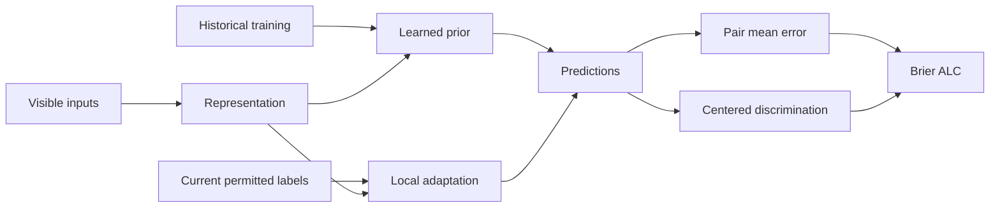

# Recognition graph v2

<!-- current-v2-r29 -->
## R22–R29 新增认识关系

| 关系 | 类型/证据强度 | 实验与边界 |
|---|---|---|
| 扩大源训练池 → 修复OOD prior | M / 当前干预不支持 | R22一折退化且仍输均值；不外推所有规模 |
| n=1硬中心化 → 丢失局部斜率信息 | M / 代数事实 | R23软约束只局部改善，不证明新solver有效 |
| metadata → 独立局部信息 | M / 小幅支持 | R25三种子与打乱控制；一折相对语义退化 |
| 更好特征覆盖 → 更好均值估计 | E / 不保证 | R26方差获取CI跨零，收益主要伴随mean项 |
| iid参数minimax → PAIEC最低平均Brier | E / 不成立的推论 | R27实测退化，损失对象/采样假设不同 |
| 奇矩偏置 → 全部先验负迁移 | M / 不充分 | R28对称化改善E3仍输均值 |
| 源任务二阶方向 → 可迁移语义子空间 | M / 本估计器不支持 | R29内层三折均rho=0，无模型增益 |

R30/R31更新：pair上限确实改变权重，实际全合格pair验证改善0.00356，仍未过门槛。下一开放节点为evaluation item上限及重复response噪声；尚未执行，不当作已验证机制。
<!-- end-current-v2-r29 -->

M = tested or proposed computational relation; E = explanatory relation. Strong/Medium/Open always refer to the stated local scope, not universal laws.

| Relation | Type / strength | Evidence / boundary | Next discriminator |
|---|---|---|---|
| Available evidence -> admissible prediction information | M / Strong by interface | Official current-budget labeled argument; no hidden state | Maintain evidence-scope tests |
| Shared hash -> prior failure | M / Open as root cause | R1 blocks help old model but lose all baseline folds | Do not expand blocks alone |
| Frozen semantic geometry + local support -> lower ALC | M / Medium | R7 three seeds, small benefit; repeated public folds | R10 correspondence control |
| Lower ALC -> better item discrimination | E / Open | ALC also responds to pair mean correction | Exact R10 decomposition |
| Semantic geometry -> transferable zero-label correctness | M / Open, chosen implementation fails | R8 prior/adaptation weaker than strong baseline | Diagnose fitting/data before architecture claims |
| Local evidence versus historical weights -> distinct generalization demands | E / Medium as organizing distinction | User A09/MN-P32; Transformer primary evidence has different setting | Do not infer an M-arrow from R7/R8 alone |
| Benchmark base-rate shift -> prior mean error | M / Open cause, supported association | Historical mean bias diagnostic | Counterfactual mean/ranking split |
| Other subjects' labels -> target prior improvement | M / Medium conditional | R9 cohort4 improves pooled ALC but fold1 worsens; exact hosted scope unknown | Scope audit and heterogeneity diagnostic |
| Reused public validation -> selection uncertainty | E / Strong methodological boundary | Many adaptive rounds on same36 benchmarks | New independently released benchmarks if available |
| Existing local geometry -> within-pair discrimination | M / Medium, controlled public result | R10:93.6% net gain centered-item; shuffled support removes gain | Oracle shrinkage envelope before another coefficient change |
| Bayesian hierarchy -> additional peer benefit | M / Unsupported after matched control | R12 fixedc4 hierarchy loses matched plug-in; adaptive gain uncertain | Stop hierarchy expansion |
| Peer mean + item slope -> complementary gains | M / Medium conditional | R13factorial, R14composition stress; interaction small | Hosted evidence scope and strong-simple comparator remain limiting |
| Global scalar ability -> target subject ordering | M / Rejected for chosen estimator | R15 rank/correction fails, limited identity coverage | Do not enlarge a single ability lookup |
| Binary1 -> common correctness/competence trait | E / False as universal public-data claim | Metadata includes lower and unordered events | Preserve outcome1 task; audit semantics |
| Label-direction mixture -> entire MLP failure | M / Not sufficient | R16 filtering barely changes ability result; oldMLP B0poor onhigher tasks | Retain other representation/formation explanations |
| Better convex shrinkage of R7 -> frozen performance gate | M / Ruled out for fixed predictions on observed replay | R17 exact empirical oracle gain0.002131<0.005 | Need additional information or changed prediction direction |
| More retained text -> useful difficulty information | M / Unsupported for tested128to256change | R18bothsemantic/lexicalslightlyworse | Do not infer absence of all text signal |
| Current peers' exact item evidence -> item effect | M / Medium conditional | R19three-seedgain0.000556; correspondencecontrol | Sparsecoverage; hostedalignmentunknown |
| Current peers' centered semantic labels -> shared item slope | M / Medium conditional | R20three-seed,matchedowncontrols,permutation | Strongpeerincrement0.002125missesgate |
| Higher-order fixed geometry -> additional reliable improvement | M / Open, not supported by currenttest | R21p4versuslinearCIcrosses0andonefoldworse | Stopdegreegrid; boundcurrentrepairfamily |

The drawing is a computation/measurement map. It is not a fully identified causal DAG. R10 tests the last decomposition and the dependence on support-label correspondence.
