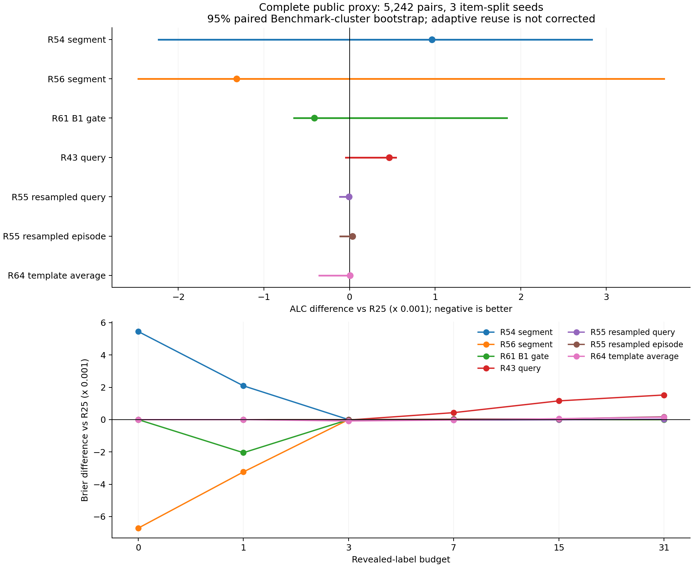

# PAIEC R62–R64：历史正面信号补证

日期：2026-10-22。控制原文：[plan_4.md](../doc/plan_4.md)。**R62、R63、R64均已完成5,242-pair×3-seed完整外层及保存概率重计分；新增fit10次、复用R43权重3份，无新embedding。** 本轮按放宽后的探索进入条件补齐了评价，所有候选均未通过原研究晋级标准。

本轮最低的探索性ALC是R56_segment的**0.193805399**，比R25低0.001318527，但收益集中、BM等权和一折退化、聚类区间跨零。R55 query的优势仅7.3e−6；R64修复了原词法平均的主要损失，但固定组合仍略差于R25。R25保持研究参照，fallback和正式提交状态不变。

## 先读什么

- 本文：实验动机、真实结果、机制认识与下一步。
- [完整指标表](historical_positive_tables.md)：六预算Brier和预测正确率、折间差异、聚类区间、Benchmark贡献。
- [机器可读汇总](historical_positive_metrics.json)；[六预算CSV](historical_positive_metrics.csv)；[逐Benchmark CSV](historical_positive_benchmark_metrics.csv)。
- [实验合同](../research_loop/HISTORICAL_POSITIVE_FOLLOWUP_SPEC.md)、[真实复现命令与原始产物目录](historical_positive_reproduction.md)、[原文与作者代码依据](../research_loop/literature/historical_positive_followup.md)、[历史信号清单](../research_loop/HISTORICAL_POSITIVE_SIGNAL_LEDGER.md)。

**评价范围：** 36个公开Benchmark、5,242个不同Benchmark–subject pairs、3个原item-split seeds，共15,726条轨迹。每条最多64个query items，保留所选item全部重复responses，pair等权；六预算0/1/3/7/15/31权重为.1/.2/.2/.2/.2/.1。没有把64-item协议称为所有query的完整评分。公开数据已反复用于开发，来源隔离和bootstrap都不能消除自适应选择偏差。三种子不是三次随机初始化。

## R62：低预算先验与首标签门控

### 1. Historical Positive Signal

R54/R56分段在旧来源池1/2改善；R61首标签门控也在两池出现小幅收益。这足以支持探索性补评，不能直接证明可迁移性。

### 2. Why Previously Stopped

旧流程要求三个来源池均改善，因此在池0退化时未做全量外层。本轮根据用户指令开放探索，没有重新选择预算分段、门控阈值或混合权重。

### 3. Execution & Isolation Audit

R54/R56现存权重只有内层半折fit，不能任选一份覆盖全部目标。本轮分别在三个外层的完整合法训练来源上refit，使用历史来源验证已选epoch `[1,2,1]`，保留原网络/AdamW/采样/risk。六个短fit完成；训练监控不用于重新挑epoch。结果明确属于 **foldwise refit of historical candidate**。

训练、标准化、校准和checkpoint选择来源与各折目标Benchmark无交集。MLP item–interactor变体与R25使用同一组responses和计数。全部36个Benchmark回放R25/两种均值，最大误差约9.25e−15；已存概率重计分误差为0。单一只读结构复核无阻断，详见[限定复核记录](historical_positive_structural_review.md)。

### 4. New Evaluation

| 方法 | pair ALC↓ | ΔR25 | Benchmark等权ALC↓ |
|---|---:|---:|---:|
| 冻结smoothed2 | 0.198687363 | +0.003563437 | 0.214868900 |
| 训练来源选择的smoothed | 0.201101132 | +0.005977206 | 0.214728460 |
| R25 | 0.195123926 | 0 | 0.212920227 |
| R54完整模型 | 0.199739239 | +0.004615313 | 0.218247419 |
| R54_segment | 0.196087126 | +0.000963200 | 0.215172817 |
| R56完整模型 | 0.196981462 | +0.001857536 | 0.218619860 |
| **R56_segment** | **0.193805399** | **−0.001318527** | **0.215241395** |
| R61_support1_gate | 0.194714357 | −0.000409569 | 0.213957091 |

R56_segment相对R25三折ΔALC为`−0.003783248 / +0.002048208 / −0.001388196`；Benchmark-cluster95%区间为`[−0.002468000,+0.003674794]`。相对smoothed2改善0.004881964，距离.005的分数门槛仍差0.000118036；即使补上这点分数，折间、BM等权和区间条件仍未通过。

R56分段的B0/B1 Brier从R25的`.250000000 / .222119481`改善到`.243287225 / .218883231`；B3–B31逐个预测保持R25。其0.5阈值预测正确率B0为58.2554%（R25为43.0466%），B1为66.7046%（R25为66.6975%）。B0的R25全部预测.5并按`≥.5`判为1，因此该正确率对tie约定敏感；Brier不依赖这个分类约定。这里是二元response预测正确率，不是被评subject本身的任务正确率。

### 5. Mechanism / Risk

**完整pair权重改变了对旧来源信号的判断。** R56分段的总ΔALC−0.001318527中，alignment_faking的加权贡献是−0.001326136，其余Benchmark合计为+0.000007609。去掉主导Benchmark后的描述性平均ΔALC为+0.000041376；这只是敏感性分析，不用于重新计分。最大BM退化为enginemt_qa的+0.026998987。

使用response加权的精确分解`Brier=Var(Y)+(mean(P)−mean(Y))²+Var(P)−2Cov(P,Y)`，B0/B1按原ALC权重合并：R56均值项Δ=−0.001288446，预测变化项Δ=−0.000030082，约97.7%收益来自均值项。与旧来源pilot相比，这里变化项有很小正面作用；不能把旧“所有variation均为成本”的结论扩大到新的外层总体。均值信息来自何种subject/item特征仍未被因果拆分。

首标签gate在约58.0%的轨迹启用R56。被拒绝轨迹的未门控B1平均ΔBrier仍为−0.002829500，入选组为−0.003530798。这说明该规则并没有清楚区分“该用/不该用”；它削弱了整体低预算增益。这里是事后诊断，未据此修改阈值或重新跑外层。

### 6. Decision

R56_segment保留为**公开开发数据上的正面探索候选**；当前证据不支持自动进入提交采用或研究晋级。R54分段停止；R61原门控停止继续微调。R25保持主要研究参照，fallback不变。

## R63：来源选择的条件修正与epoch0回退

### 1. Historical Positive Signal

原R43 query和R55 resampled_query只有来源池2小幅改善，池0/1选epoch0；R55 episode三个来源池点估计均改善，但前两池幅度极小。

### 2. Why Previously Stopped

旧三来源严格改善条件截断了外层。本轮无需再次通过旧门槛，直接检验来源选出的固定策略。

### 3. Execution & Isolation Audit

R43复用两份迁移归档中hash相同、可追溯到原全来源refit的三份权重，epoch `[0,0,20]`。R55 query固定`[0,0,17]`，episode固定`[1,20,17]`，仅执行4个非零epoch的全来源refit，约31秒。R55标准化仅fit数据拟合，保持历史episode seeds。全部15,726条外层轨迹的身份、计数与R62一致；B0/B1不变，epoch0折的全部预测与R25一致；概率重计分误差为0。

### 4. New Evaluation

| 方法 | ALC↓ | ΔR25 | 95% cluster CI（ΔR25） |
|---|---:|---:|---|
| R43 query_best20 | 0.195589543 | +0.000465617 | [−0.000044877,+0.000542463] |
| R55 resampled_query | 0.195116628 | −0.000007298 | [−0.000112022,+0.000003252] |
| R55 resampled_episode | 0.195157298 | +0.000033372 | [−0.000109509,+0.000048595] |

R43三折Δ为`0 / 0 / +0.000551835`；R55 query为`0 / 0 / −0.000008649`。R55 query在B3/B7/B15分别约改善0.000012860/0.000027356/0.000011224，但B31退化0.000029901。不能声称覆盖B0/B1。

### 5. Mechanism / Risk

来源epoch0策略在前两折按构造保持R25，**不证明它能在未知目标上识别该回退的时候**。第三折原R43仍退化，反证了“来源选择即可保证目标零风险”。本轮没有评价未选checkpoint并事后挑目标最优。

R55 query对episode的ΔALC为−0.000040670，cluster95%区间`[−0.000052783,+0.000036786]`，三折方向不一致；尚无稳定的query特有增益。R55 query明显好于本轮原R43，但二者还具有已选epoch和全来源数据排列差异，不能将差值单独归因于重采样。

三个条件候选合并评价耗时约286秒。各修正网络只有417个参数，但还需要局部统计、LOO/矩阵计算与版本维护；这不是正式线上时延验收。相对R25仅约7.3e−6的非稳健优势，不足以支持增加部署路径。

### 6. Decision

三种条件修正均未晋级。停止原R43/R55配置的进一步幅度/epoch搜索；保留训练和来源回退证据，不把负结果扩展为所有条件学习方法无效。

## R64：词法模板在强R25上的独立增量

### 1. Historical Positive Signal

R42模板词法对原词法三来源池有小幅改善，但不是对R25的直接收益；原R46等权组合完整外层已失败。

### 2. Why Previously Stopped

弱词法对照改善和两池BM等权退化不足以证明能与R25组合。本轮只做一个受控替换：保持R25、metadata、ridge及.5/.5平均不变，将原词法换成当前支持输入决定的模板词法。

### 3. Execution & Isolation Audit

模板仅使用当前n个支持输入，未使用query标签或未来支持输入；不训练新模型、不生成新语义向量。原R42逐pair数值回放通过。824次来源池暴露对应412不同pair，池间重叠；pilot不是独立外层证据。

### 4. New Evaluation

来源三池相对R25 ΔALC为`−0.000250540 / −0.000136317 / −0.000812583`；合并暴露Δ=−0.000383657，BM等权Δ=−0.000514283，相对原平均再改善0.000076224，满足评分前冻结进入条件。因此实际执行了同一候选的完整外层，耗时约730秒；R25、原词法、原R46平均回放通过，保存概率重计分误差为0。

| 方法 | 完整外层ALC↓ | ΔR25 |
|---|---:|---:|
| 原词法 | 0.197343986 | +0.002220060 |
| 模板词法 | 0.195499115 | +0.000375189 |
| R46原等权平均 | 0.196033067 | +0.000909141 |
| **R64模板等权平均** | **0.195129047** | **+0.000005121** |

R64对R25三折Δ为`+0.000047836 / −0.000188526 / +0.000018534`，cluster95%区间`[−0.000356024,+0.000034970]`；Benchmark等权ALC0.212466730，比R25改善0.000453497，25/36个Benchmark改善、1个相同。然而pair等权总体未改善，不能用BM结果替换真正计分指标。

### 5. Mechanism / Risk

核心诊断为精确平方损失差`ΔBrier=2E[(p−y)d]+E[d²]`，区分残差对齐与预测位移成本。这是代数归因，不单独构成因果证明。四个query置换仅在clip前保持item等权残差均值，不保证response加权均值或clip后均值；不能据其差异宣称纯item对应关系因果效应。

相对R25，残差对齐项为−0.000177352，位移成本为+0.000182473，几乎抵消后净退化+0.000005121。说明当前模板词法包含与残差有关的信号，但固定组合没有实现净收益；不是“完全没有词法信息”。相比原R46平均，模板替换改善0.000904020，聚类区间仍跨零`[−0.001060744,+0.000010915]`，主要改善来自fold2。

预算方向也不同：B3/B7改善约0.000085113/0.000023805，B15/B31退化约0.000059317/0.000150413；B0/B1完全不变。alignment_faking加权贡献+0.000036331，其余Benchmark合计−0.000031210。真实模板组合在四个置换对照前均有优势，但上述计数权重/clip限制继续成立，不能据此绕过主指标。

### 6. Decision

停止本轮固定模板平均路线，保留“模板处理修复词法冗余”的机制证据；未晋级，不扫描融合权重、按预算重新选择模型或事后删除主导Benchmark。

## 全轮决策与下一步

1. **本轮补证完成，研究Success Gate未达到。** 没有候选相对smoothed2达到.005，同时满足折间、BM等权、CI和机制条件。R56_segment虽距单一分数阈值只差0.000118036，其他失败条件仍独立存在。
2. **下轮最有价值的问题是先验的可迁移可靠性。** R56低预算的均值信息比R43幅度修正显示了更大的公开点估计空间，但当前无法用首标签规则可靠识别。优先争取未参与选题/模型选择的来源证据，或基于新增合法输入提出可证伪的可靠性诊断；不要先在这批外层结果上搜新阈值、mix或组合。没有新数据时，只能继续标记为探索性研究。
3. **保留词法模板的修复作用，降低投入优先级。** 它确实改善原词法与原平均的点估计，却没有提供对R25的净增量。R43/R55当前配置不再扩大训练或调参。
4. **R25/fallback与其他分支。** R25 ALC0.195123926继续作为主要研究参照；R56_segment仅保留为探索候选，不自动替换。fallback SHA256保持，未正式提交；ADeLe继续等待资源；跨subject共享和像素分支仍需明确输入契约。完整历史条件见[信号清单](../research_loop/HISTORICAL_POSITIVE_SIGNAL_LEDGER.md)。

图表脚本：`research_loop/render_historical_positive_figures.py`；提供PNG/SVG/PDF。表格脚本：`research_loop/summarize_historical_positive_reports.py`。R62从首次评价合同冻结至结束约22分41秒，包含慢速中断和等价缓存续跑；不能只报缓存路径约395秒。R63完整评价约286秒，R64 pilot约141秒、完整评价约730秒。这些是AI/批处理窗口或脚本实测时间，不是人类投入时间。

## 当前工程和证据状态

训练/模型选择隔离原理依照DomainBed原文§3–3.1及[固定作者实现](https://github.com/facebookresearch/DomainBed/blob/b93c22a1cfc3b2428398272c1a116c8de1f4139e/domainbed/model_selection.py)，保留PAIEC自己的网络、Brier和原两分组选择程序。R42模板是项目自定义干预，没有冒称外部论文算法。

为控制R62编码成本，新增数值等价缓存；原慢速产物和中断记录保留，7个重叠chunk的2867200数组值逐字节一致。原始prompt、R1–R61、R25和fallback未覆盖。没有正式提交。ADeLe仍按用户要求等待资源。
