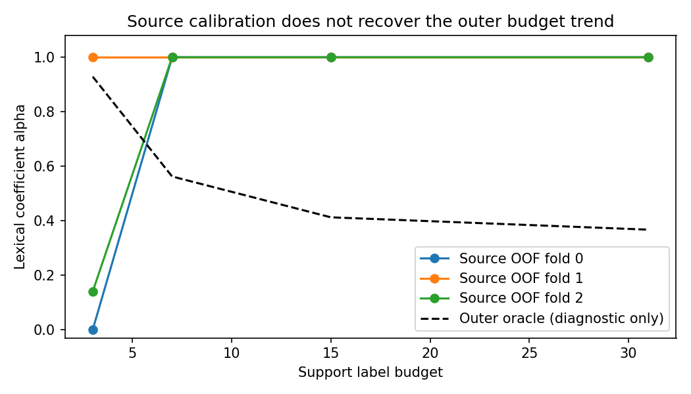
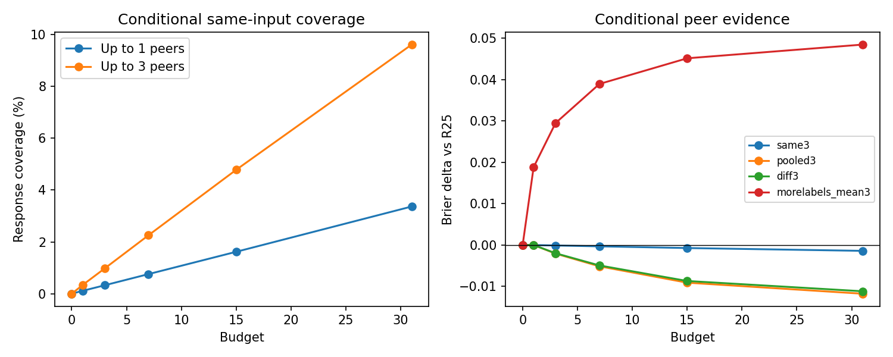

# R69–R72：词法残差与跨 Subject 当前证据

执行日期：2026-10-23（Asia/Shanghai）。用户原计划：[plan_6.md](../doc/plan_6.md)。

本文对应一次事前冻结的公开探索实验。完整统计见[数值与正确率表](lexical_peer_evidence_tables.md)，实际命令、数据版本、数组读取方法见[复现与存储说明](lexical_peer_evidence_reproduction.md)。所有 R72 分数均为 `conditional_simulation`，没有实际 Hosted 成绩。

**执行结论：** R69–R72 已完成。R70/R71 未把词法残差转成总分增益；R72 pooled3 在条件共享场景达到 **0.190683911 ALC**，比 R25 改善 **0.004440014**，通过条件场景数值门槛。保留该研究候选，等待真实运行时合同，不自动部署或提交。

## 1. Existing Positive Evidence

**R64 的局部信号成立，但净增益未成立。** 原模板词法等权组合的 ALC 为 0.195129046979，R25 为 0.195123925976。以 R25 为起点，R64 的残差对齐项为 −0.000177352289，平方位移成本为 +0.000182473292，净变化为 +0.000005121003。B3/B7 有利、B15/B31 不利。这足以提出“收缩可能减少成本”的假设，不能据已见外层答案确定部署系数。

**R20/R36 提供条件共享的线索。** 旧共享实验相对强 own-only 对照只有约 0.0000717 ALC 的增量、一折退化且 Benchmark 聚类区间跨零；旧结果没有解决真实 peer 可见范围。R72 因此使用当前合法 acquisition 证据、重新审计的可见身份和匹配强对照，单独检验同输入与异输入信息。

旧证据入口：[历史正面信号报告](historical_positive_followup_findings.md)、[R65–R68 机制报告](transferable_prior_mechanism_findings.md)。原 R25、R56_segment、R64 和 fallback 不因本轮结果而重选或覆盖。

## 2. Remaining Unknown

1. **预算规律能否迁移？** 总体外层最优系数下降，可能由少数大 Benchmark 的权重决定；来源内不一定能估计同一趋势。
2. **可靠性是否可观察？** 词法和语义最近支持项一致，可能表示证据可靠，也可能仅表示两种表示冗余。必须比较等平方位移成本下的残差对齐。
3. **peer 信息是否在一次调用中真实可见？** 官方多 pair 接口、公开客户端和私有 coordinator 的抽样行为属于不同证据层。是否存在跨 subject acquisition/query 重叠、可匹配比例及部署延迟，仍需实际 runtime 样例。

可证伪假设与停止规则已写入[冻结合同](../research_loop/LEXICAL_PEER_EVIDENCE_SPEC.md)。没有新增 MLP、编码器、可靠性网络或参数网格。

## 3. Runtime Contract Findings

通过 AnySearch 发现并提取原始材料，读取[官方规范](https://aims.stanford.edu/competition/)与[官方代码](https://github.com/aims-foundations/paiec_baseline/tree/cc88a959c1e5e7462f31a9215baba066ce6d6e2b)。固定 repo commit：`cc88a959c1e5e7462f31a9215baba066ce6d6e2b`。

|问题|已获得的证据|边界|
|---|---|---|
|多 pair 证据|官方说明 labeled 跨 sampled subject–benchmark pairs；streaming client 的 evaluation event 将同一 labeled 传给 prediction stream|未观察私有 coordinator 的 peer 数量与组成|
|字段与身份|subject 为完整八字段字典；item 有正文、features、interactors、匿名 benchmark_id；未提供 item_id|相同正文不能代替完整输入身份；重复可见 subject 配置不能靠内部 ID 区分|
|预算与标签|B0 空；每 pair 预算 0/1/3/7/15/31，嵌套；own acquisition/evaluation 按 item 分离；重复 response 留在同侧|跨 subject 的题目划分及重叠规则未知|
|调用状态|客户端说明 coordinator 管理证据，worker 在 checkpoint 重建|本轮预测只读当前证据，不依赖跨调用内存|
|真实运行时|没有真实 Hosted 输入或执行记录|`verified_runtime` 条款数为 0；不能称已验证 Hosted 共享效果|

当前机器入口：[PAIEC_RUNTIME_EVIDENCE_CONTRACT_FINAL.json](../research_loop/PAIEC_RUNTIME_EVIDENCE_CONTRACT_FINAL.json)。19 条事实/推断/未知/不支持项、原文行定位和组织者问题见[运行时合同](../research_loop/PAIEC_RUNTIME_EVIDENCE_CONTRACT.md)。初始 JSON 与 client 补证 JSON 分别保留原冻结版本，最终 JSON 汇总最新定位。Codabench 公开材料有提取/TLS 失败，失败记录保留；没有绕过访问限制，也没有发送组织者消息。

### 原文与作者实现的使用范围

R70 的约束子问题采用 Busing 的加权 PAVA：[正式论文](https://doi.org/10.18637/jss.v102.c01) Eq.(1)、Algorithm 1，以及[作者 monotone 代码](https://github.com/cran/monotone/tree/36c17fa4b03ac20b8d0a801c9f75ba83b68fe65c)。实际执行使用 SciPy 1.13.1 的 `isotonic_regression`，已核对其官方源码与引用。该论文不主张 PAIEC 的预算系数应递减；这里的递减约束是本轮待检验假设。

来源分组选择借鉴已归档读取的 DomainBed 原文 §3–3.1 与作者 `model_selection.py`。本轮是基于原文和代码的子算法复用与 PAIEC 机制实验，没有宣称复现两篇论文的全部结果。peer 算子继承项目 R25/R64/R20/R36 冻结实现。精确版本、PDF hash、代码定位见[文献与实现对应表](../research_loop/literature/lexical_peer_evidence.md)。

## 4. Mechanism Experiments

### 4.1 统一协议与来源隔离

- 外层：36 Benchmarks、5,242 pairs、seed 0/1/2、15,726 trajectories、六预算；固定原来的最多 64 query items，保留全部 query variants 和重复 response 计数。
- 主指标：每 pair 内 response 计数加权、pair/seed 等权，ALC 权重为 `[.1,.2,.2,.2,.2,.1]`。另报 Benchmark 等权、三 fold、三 seed、10,000 次 Benchmark-cluster paired bootstrap、逐 Benchmark 回归和预测正确率。
- 来源：412 个不同 pair，进入三个重叠来源池共 824 次；不能称为 824 个独立 pair。固定 source seed 73、每 Benchmark 至多 25 pairs。
- 旧 R64 source 预测的 ridge 由整个来源池选择，不能直接称严格 OOF。重建固定 inner-half 的 base 预测，ridge 仅由另一 half 选择；最终 α 拟合来源 OOF。来源 CV 另外在 fit half 同时确定 ridge/α，仅在 held-out half 计分，避免模型选择的间接泄漏。
- 原外层 Benchmark 已多轮用于研究；本轮虽然冻结后一次运行，仍是自适应探索证据，bootstrap 不能消除该选择偏差。

### 4.2 R70：预算收缩

令 `p=R25`、`d=(template_lexical−p)/2`，因此 α=1 恢复 R64。来源 OOF 上估计 `A=E[(p−y)d]`、`C=E[d²]`：

1. **independent**：各预算 `clip(−A/C,0,1)`。
2. **monotone**：B3–B31 非增 PAVA，权重为 `ALC_weight×C`，最后裁剪到 `[0,1]`。
3. **global**：四预算合并为一个 α，控制仅缩小整体修正幅度的影响。

B0/B1 的 d=0；零成本回退。α∈[0,1] 保证位于两个有效概率之间，线性修正无需额外裁剪。外层 oracle 只用于解释该算子族的空间，未回填参数。

### 4.3 R71：一个可观察分组与两类对照

仅冻结一个二值变量：**词法与语义+metadata 的余弦最近支持项是否一致**。按预算×两组拟合保守 α；少于 20 个活跃来源 pair 或 3 个 Benchmark 时回退 R25。不做阈值扫描、变量筛选或新 MLP。

- 4 次 support-label permutation：每预算允许的前缀内打乱标签，重新计算 R25、词法和所有标签相关量。判断新增词法价值时比较各自相对 R25 的增量，不能只看置换后的绝对分数变差。
- 4 次随机选择：逐 trajectory/预算精确匹配 `Σcount×(αd)²`，比较相同平方位移成本时的残差对齐。只用 query 输入和计数，不使用 query outcome；它是离线机制对照，不是部署候选。
- R71 已包含预算条件；只有它提供独立增量才组合 R70+R71。本轮没有通过该进入条件。

**异常记录：** 初次诊断控制误把含 query successes 的审计 identity 用作 RNG key。单一只读结构复核发现后即中止；错误部分批次保留在 `R71/invalid_control_seed_20261023`。改为仅 benchmark/subject/split seed 后完整重跑，最终统计排除错误批次。非置换候选公式和 R70 不受该问题影响。见 [structural_review.md](../paiec_baseline/runs/research_loop/R69/structural_review.md)。

### 4.4 R72：覆盖率先行的条件共享回放

在不查看 query outcome 的覆盖率审计后冻结[R72 算子合同](../research_loop/R72_OPERATOR_CONTRACT.md)：按完整可见 subject 配置确定每组至多 4 subjects，比较 0/1/3 peers。相同可见配置的 subjects 排除共享、回退 own-only；内部 ID 仅作离线查表/审计，不用于推理身份。每个 peer 只暴露自身 acquisition 前缀。

完整匹配键为 benchmark、正文、features、interactors；同正文不同 metadata 不合并。部分 Benchmark 的同可见键对应多个内部 item，因此报告“同可见输入”，不保证潜在题目身份唯一。3-peer 情景平均实际 2.9611 peers；B1/B3/B7/B15/B31 同输入 response 覆盖约 0.3377%/0.9730%/2.2550%/4.7811%/9.6104%。1-peer 的 B31 覆盖为 3.3639%。每 Benchmark 的配置歧义、无 peer 数与覆盖在数值表中。

|方法|冻结操作|
|---|---|
|nopeer|严格回退原 R25|
|same1 / same3|同可见输入的 peer outcome 减去该 peer 当前标签均值，以 `sum(residual)/(4+m)` 修正 R25；n≤1 不修正|
|pooled1 / pooled3|R25 同一 640 维语义+metadata 表示，各 subject 内中心化的联合 ridge；own 均值、固定 ridge1|
|diff3|对每个 query 删除所有同可见输入的 peer 标签，再重新中心化和拟合；没有命中时与 pooled3 相同|
|morelabels_mean3|只用更多可见标签改变平滑均值，保留 R25 局部方向|
|R36_own_pooled3 / R20_peer_pooled3|原 384 维语义共享方向与来源选定 ridge，分别用 own 均值/peer 层级均值；在新相同 cohort 中重算|
|两次 peer 置换|逐 peer、逐合法预算前缀打乱 outcome，own 标签保持；重算所有中心化、删点与拟合|

R36/R20 对照不是直接搬用旧 cohort 的总分。原公式在每 Benchmark/seed 抽样回放；无 peer 和 B0 严格回退检查嵌入完整运行。4,062 个 cohort-seed 输入组的最大不同可见输入数为 380，未超过官方 1,000 限制；interactor 序列化审计未发现字符串碰撞。该检查不等价于 Hosted 的资源/速度验收。

`pooled3−diff3` 同时改变标签数和设计矩阵，不能当作纯粹的“相同 item 身份”的因果效应。0/1/3 peer 是冻结的条件覆盖敏感性分析，不是从全库挑选最有利 peers。

## 5. Numerical Results

R70、R71、R72 均已完成全部 5,242 pairs × 3 seeds × 6 budgets。下表 Δ 为候选减 R25，负值更好。CI 为 Benchmark-cluster paired bootstrap 的探索性区间。

|方法|Pair-equal ALC ↓|ΔR25|ΔR25 的 95% CI|
|---|---:|---:|---|
|冻结 smoothed mean 2|0.198687363|+0.003563437|—|
|训练来源选定 smoothed mean|0.201101132|+0.005977206|—|
|R25|0.195123926|0|—|
|R56_segment（旧探索结果）|0.193805399|−0.001318527|[−0.002468000, +0.003674794]|
|R64 / R70 monotone / R70 global|0.195129047|+0.000005121|[−0.000356024, +0.000034970]|
|R70 independent|0.195141845|+0.000017919|[−0.000355060, +0.000049143]|
|R71 grouped|0.195138171|+0.000014245|[−0.000338141, +0.000043901]|
|R72 nopeer|0.195123926|0|[0, 0]|
|R72 same1|0.194999505|−0.000124421|[−0.000221266, −0.000083029]|
|R72 same3|0.194752318|−0.000371608|[−0.000643296, −0.000222177]|
|R72 pooled1|0.193447869|−0.001676057|[−0.001918204, +0.000016163]|
|**R72 pooled3**|**0.190683911**|**−0.004440014**|**[−0.005055159, −0.000319164]**|
|R72 diff3|0.190885868|−0.004238058|[−0.004863359, −0.000010346]|
|R72 morelabels_mean3|0.226433089|+0.031309163|[−0.003815915, +0.036848426]|
|R36 own_pooled3（匹配新 cohort）|0.195102100|−0.000021826|[−0.001819186, +0.000157902]|
|R20 peer_pooled3（匹配新 cohort）|0.197593555|+0.002469629|[−0.006696413, +0.003915526]|

R72 pooled3 的 Benchmark-equal ALC 为 **0.211915690**，R25 为 0.212920227。它的三 fold ΔR25 为 **−0.001421008 / −0.000698942 / −0.005064177**；3 seeds 的 ALC 标准差为 0.000027302。36 Benchmarks 中 16 改善、10 不变、10 退化；最大新增回归为 dave 的 +0.002515300。

`alignment_faking` 贡献 −0.004278140，占总改善 **96.35%**；其余 Benchmark 的加权贡献为 −0.000161875。去除 alignment 后，剩余 pairs 重新归一化的 ΔR25 为 **−0.000880235**。总体增益不只出现在 alignment，但其权重决定了大部分总分收益。

### 5.1 正确率与六预算

“正确率”是以 `p≥0.5` 预测 response 成功/失败的分类正确率，不是 subject 原始答题成功率；B0 的 0.5 在此规则下统一预测成功。竞赛主指标仍为概率 Brier ALC。

|预算|R25 Brier|pooled3 Brier|R25 正确率|pooled3 正确率|
|---|---:|---:|---:|---:|
|0|0.250000000|0.250000000|43.0466%|43.0466%|
|1|0.222119481|0.222119481|66.6975%|66.6975%|
|3|0.198842814|0.196766379|68.9930%|69.1067%|
|7|0.181623410|0.176476829|71.2369%|72.5954%|
|15|0.169054986|0.159961324|73.7518%|75.9363%|
|31|0.157957879|0.146191090|76.3170%|79.0026%|

本轮 centered pooled/same-input 方法 B0/B1 不变是算子构造，不证明这些预算不存在其他可用信息。peer 均值类控制可以改变 B1，但本轮结果不支持用其替代 own 均值。所有方法的六预算正确率、Brier、三 fold 与逐 Benchmark 表均已保存。

### 5.2 与强共享对照和旧先验的比较

- pooled3 − R56_segment：**−0.003121487**，CI **[−0.004235546, +0.001169797]**；fold0 退化 +0.002362240。不能宣称对 R56 已形成稳定优胜，也未事后组合两者。
- pooled3 − 匹配 R36：**−0.004418189**，CI **[−0.005178354, +0.000525104]**；三 fold 点估计均改善，但 Benchmark-equal **+0.000091650**，略差于 R36。新表示/尺度与共享的总体效果较好，不能据此宣称普遍支配 R36。
- diff3 − pooled3：**+0.000201956**，CI **[+0.000166431, +0.000499424]**。删掉同输入证据后，仍保留 **95.45%** 的 ΔR25 点估计收益；此比例是算子消融描述，不是同输入信息的因果份额。
- pooled1 的 ΔR25 区间略跨零；same3 的小收益区间完全低于零。覆盖量与方法之间存在敏感性，不能将三 peer 的收益外推为任意 peer 数都成立。

### 5.3 数值门槛、失败切片与验证

条件模拟中的 pooled1、pooled3、diff3 通过既有**数值条件**：相对两均值基线总体至少改善 0.005，三 fold 与 BM-equal 改善，cluster CI 上界低于零，未触发原 0.03 严重回归标记。pooled3 相对 frozen smoothed2 改善 **0.008003451**，相对训练来源选定均值改善 **0.010417221**。

这不替代逐 Benchmark 解释。pooled3 相对训练来源均值仍有四个 ≥0.005 的回归：

|Benchmark|pooled3 − 训练均值|原 R25 − 训练均值|本轮 pooled3 − R25|
|---|---:|---:|---:|
|cellverse|+0.013352775|+0.013352775|0（无 peer）|
|cruxeval|+0.006642379|+0.007842135|−0.001199756|
|dave|+0.007259947|+0.004744648|+0.002515300|
|egoschema|+0.009599015|+0.008330946|+0.001268068|

前两项全部或部分继承原 R25 的不足；后两项新增退化尚无被独立验证的任务机制解释。没有根据这些外层失败切片调整 peer 权重。数值门槛通过只记录为**条件场景下的研究候选**，真实输入一致性、局部回归和独立确认仍未完成。

保存概率重计分覆盖每阶段 **149 个 chunks、1,005,741 query variant rows、15,726 trajectories**。R70/R71 最大 Brier 误差 8.88e−16，R72 为 9.99e−16；accuracy 重计误差均为 0。R71 随机控制的原始计数加权能量匹配误差 ≤1.42e−14。R72 另对每 Benchmark/seed 首条轨迹共 108 条，以去掉 peers 的联合求解器重新生成 R25，误差 ≤2.22e−16；该补充审计不用于改参数或选候选。

实际四线程 CPU 批处理 wall time：source bank 162.92 秒、R70 外层 73.59 秒、R71 正确重跑 1,389.70 秒、R72 外层 1,410.69 秒；三阶段概率重计分约 29.58/101.60/75.19 秒。这些是多候选批量计算时间，包含缓存/I/O/控制，不是单次 Hosted 延迟，也不是用户投入时间。没有新神经网络训练或 embedding 重算；有低维来源系数拟合。

## 6. High-Level Understanding

### Q1：预算变化能否稳定解释并提取词法收益？

**当前来源估计没有做到；整体外层趋势不能代表可迁移规律。** 三来源 independent 的 B3–B31 α 分别为 `[0,1,1,1]`、`[1,1,1,1]`、`[0.140093,1,1,1]`；monotone/global 最终均为全 1，即原 R64。它们与外层事后 oracle 的 `[0.928869,0.562489,0.412599,0.367278]` 不一致。

35 个非零修正 Benchmark 只有 **15 个**呈非增 oracle 趋势；fold0 的 oracle 反而随预算增加。即便允许用外层答案挑每个 fold/预算的 α，当前固定 R64 残差族也最多改善 **0.000055857 ALC**；全局四预算 oracle 为 0.000048373。该上界仅限当前 `α∈[0,1]` 的固定残差，不是所有词法模型的上界。

失败层次：**外层聚合规律不能由来源 OOF 稳定迁移；当前残差族的幅度优化空间也很小。** 不把它解释为“文本词法没有信息”。

### Q2：合法条件能否保住有利词法修正？

**本轮最近支持项一致性没有完成可靠筛选。**

|方法|残差对齐项 2A|位移成本 C|净 ΔR25|
|---|---:|---:|---:|
|R64|−0.000177352289|+0.000182473292|+0.000005121003|
|R70 independent|−0.000146769344|+0.000164688129|+0.000017918785|
|R71 grouped|−0.000122665785|+0.000136910338|+0.000014244553|

R71 减少了成本，同时损失了更大的有利对齐幅度；同能量随机控制的点估计还比它好约 8.29e−6–11.36e−6，但差值 CI 跨零。各预算的一致组优于不一致组，仅出现于 14/34、14/35、17/35、16/35 个可比较 Benchmarks，方向不稳定。

支持对应被打乱会损害绝对预测，但词法修正相对“同样被打乱的 R25”的平均增量反而更有利：R71 正确增量 +0.000014245，置换后的平均增量 −0.000344176。说明当语义支持方向被破坏时，平均/收缩还可能缓和错误；不能用绝对置换下降证明新增词法筛选成功。

失败层次：**词法残差有对齐信号，但这个可见条件无法在相同成本下稳定辨认有用部分。** 不据事后分组 oracle 翻转条件，不扩张可靠性网络。

### Q3：是否有可用跨 Subject 当前证据及独立增量？

**接口层面有官方依据，实际输入分布尚未观察；条件实验中出现了可信的增量证据。**

1. **同可见输入 outcome 提供小而一致的条件收益。** same3 ΔR25 −0.000371608、三 fold 改善、cluster CI 低于零。真实对应比两次 peer 置换分别好 0.000520936/0.000523279。它只修正可匹配输入；B31 覆盖仅 9.61%，限制了总体作用。
2. **共享局部结构是较大的收益来源。** pooled3 ΔR25 −0.004440014；删除同输入记录仍改善 0.004238058。无可接受唯一匹配的 query 切片贡献约 −0.004004738 ALC。切片定义排除了同 peer 内的重复键，diff3 则删除所有同键，因此两者在该切片有极小差异，不能将该数字当成严格的全无重叠实验。
3. **结果依赖 peer 的标签对应，而不只是更多输入或标签数量。** pooled3 在两次 peer 置换后的 ALC 为 0.197211641/0.197275216，均差于 R25；真实对应相对置换改善 0.006527730/0.006591305，cluster CI 均低于零。均值控制则退化至 0.226433089。共享 subject 内中心化方向并保留 own 截距，符合当前数据中的成功机制；“直接借用 peer 整体能力”没有同样证据。
4. **表示与共享方式有耦合，但原因尚未拆净。** 同 cohort 的原 R36 仅改善约 0.000021826；R25 的语义+metadata、尺度和 ridge 配置下共享较好。两者同时改变了表示与正则尺度，不能把差异归因于 metadata 单一因素。R36 在 BM-equal 上略优也说明总体排名受来源权重影响。
5. **可迁移性需要限定。** 本轮指固定算子用于留出 Benchmark、在其当前合法标签上估计结构，并不意味着历史模型已经学会通用 item 难度。16/36 BM 改善、96.35% 增益来自 alignment、R56/R36 比较区间跨零、仅两个 peer 置换和一个固定 cohort 划分，都限制了结论的强度。

因此，信息不足不是 R72 的主要否定结论。现在的证据更支持：**在所声明的当前标签可见场景中，peer 提供了 R25 own-only 未覆盖的局部结构；能否用于正式比赛，仍取决于真实 peer 组成和输入条件。** 私有 coordinator 未确认不能被说成“Hosted 一定不支持”，也不能被说成“已经可部署”。

## 7. Research / Submission Decision

|方向|决定|依据|
|---|---|---|
|R69|完成公开合同核查；真实运行时样例待取得|官方多 pair/client 证据齐备；coordinator 与实际 peer 分布未知|
|R70|停止当前预算系数族|来源规律不迁移；外层净增益未成立；固定残差族 oracle 空间有限|
|R71|停止当前近邻一致性分组；不叠加 R70|没有胜过 R25/原 R64，未优于等能量随机选择；不扩门控|
|R72 same3|保留小收益条件证据|强 own-only 增量和对应关系对照支持；覆盖低，未达原 .005 门槛|
|R72 pooled3 / diff3|优先保留为条件共享研究候选|当前条件模拟数值门槛通过；三 fold/cluster 支持相对 R25 的增量|
|R72 pooled1|保留覆盖敏感性结果|对均值基线过数值门槛，但相对 R25 CI 跨零|
|R72 均值共享与原 R20 配置|停止当前直接替代方式|pair-equal 主指标退化；BM-equal 好不能替代计分目标|
|Hosted 晋级/正式提交|未执行|运行时输入分布未确认，局部回归及独立确认未解决|

原 R25、R56_segment、R64、旧冻结资产及两份 `smoothed_mean_strength2.zip` 保持不变。没有依据新分数自动替换候选或提交。ADeLe 继续按用户决定等待资源。

## 8. Next Move

1. **优先取得一个真实 Hosted evaluation event 的去敏输入样例或 coordinator 的公开抽样说明。** 只需确认同 Benchmark peer 数量、完整可见 subject 可区分性、跨 subject acquisition/query 划分与重叠、预算和最大输入规模。询问文本已存于运行时合同，未自动发送。
2. **在真实输入分布上重放已冻结 pooled3/diff3/same3/R25，不先调参。** 当前 0/1/3-peer 曲线是敏感性证据；下一次的价值是验证可用性与转移，不是继续优化这批公开外层的分数。确认无法共享时，保留本轮条件结果并回退 R25。
3. **若实际 peer 可用，再单独识别表示与共享的交互。** 一个事前固定的小型因素对照：在相同当前证据、尺度与计算预算下比较语义/语义+metadata，再独立改变正则；同时检查 dave、egoschema 的新增回归。新参数只能从合法来源选择，已查看的外层切片只用于提出假设。
4. **暂不把 R56 低预算先验直接拼入 pooled3。** pooled3 的 B0/B1 留空与 R56 的局部优势提供组合动机，但本轮对 R56 的跨 BM 证据不足；若后续另行进入组合，应先冻结来源内选择和独立确认协议。

完整产物包括逐项概率、计数/身份、来源 OOF 系数、置换控制、公式审计、原文/代码版本、异常批次、运行时间与逐文件 hash。最终交付核对见 [delivery_validation.json](../paiec_baseline/runs/research_loop/R72/delivery_validation.json)，逐文件索引见 [delivery_manifest.json](../paiec_baseline/runs/research_loop/R72/delivery_manifest.json)。
