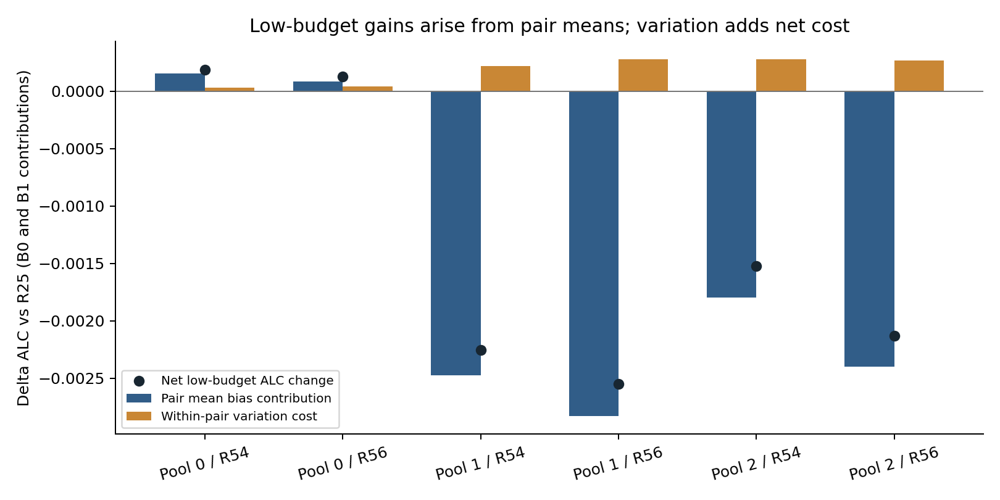
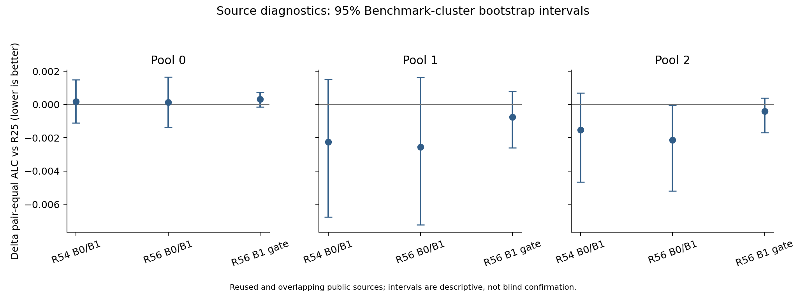

# PAIEC R59–R61：低预算先验互补性、条件组合与机制认识

记录日期：2026-10-22。原始要求：[plan_3.md](../doc/plan_3.md)。R59诊断、R60唯一候选及R61来源pilot均已实际完成；R61完整外层评价为`condition_not_met`。新增训练0次，未改R25研究参照、提交fallback或正式提交。

## 1. Current Bottleneck — 当前瓶颈

**部分来源确有可利用的平均概率优势，但当前证据不足以在未知Benchmark上可靠判断何时采用。** 低预算分段和一个允许标签的门控均未通过三个来源池的联合条件。

历史5242pair×3item-split种子的R25 ALC为0.195123926、smoothed2为0.198687363，目标≤0.193687363。本轮使用不同来源pilot总体，不与历史总体混排；没有新的隐藏或全量成绩。

## 2. Upward Diagnosis — R59机制更新

使用每pair原response计数计算恒等式：

`Brier = Var(Y) + (mean(P)−mean(Y))² + Var(P) − 2Cov(P,Y)`。

先在pair内按response计数平均，再在pair之间等权。这里的Var(Y)不是不可约噪声；mean-bias平方不是跨训练样本的估计偏差，Var(P)也不是参数估计方差。本轮只有单一训练初始化，不能声称已完成统计学习意义的bias–variance分解。

**H1/H2：总体收益来自pair mean，而非净正向item discrimination。** 下表将B0/B1分别乘.1/.2，因此两项和恰好等于预算分段相对R25的ALC变化；负值为改善。

| 池 | 模型 | pair均值项 ΔALC | pair内变化项 ΔALC | 合计 ΔALC |
| --- | --- | --- | --- | --- |
| 0 | R54 | +0.000155687 | +0.000030567 | +0.000186254 |
| 0 | R56 | +0.000084738 | +0.000043212 | +0.000127949 |
| 1 | R54 | -0.002473986 | +0.000219078 | -0.002254909 |
| 1 | R56 | -0.002828846 | +0.000278702 | -0.002550145 |
| 2 | R54 | -0.001799830 | +0.000278404 | -0.001521426 |
| 2 | R56 | -0.002399477 | +0.000269942 | -0.002129535 |

六个模型×池的variation项均为正。池1/2的pair均值改善超过总净收益，因为同pair内各题/variant间的概率变化抵消了部分收益。它不证明每个Benchmark都无item信号，也没有将pair均值来源进一步因果分离为subject属性或item内容的平均效应；这两者仍混合。

**H4：R56主要改善均值项，没有提供新的独立信息源证据。** R56相对匹配R54，三个池B0预测方差均增大；池0/1的净variation成本更高，池2略降低。R56的低预算总改善由均值项主导。因此不能解释成普遍缩小预测方差，也不能从不同训练风险直接声称获得独立信息。



**H3：存在来源异质性，不能据此断言唯一原因是偶然匹配。** R56预算分段改善Benchmark数量为12/26、13/23、17/23；池0整体退化。池1中bird_sql贡献净改善约72.6%；去掉它后ΔALC仍为-0.000774326; 池2中bird_sql贡献净改善约64.0%；去掉它后ΔALC仍为-0.000853695。收益不是只来自一个Benchmark，但幅度明显受其影响。完整移除单Benchmark敏感性与所有回归保存在R59/composition_audit.json；不是事后删除不利Benchmark后重新计分。

**能否由预测时合法信息识别？** 下面ρ在每个Benchmark先平均signal和相对R25收益，再对Benchmark等权计算Spearman，正值代表signal越大收益越高。来源池重叠，三个同方向不等于三次独立复制。

| 可见信号（R56） | 预算 | 池0 ρ | 池1 ρ | 池2 ρ |
| --- | --- | --- | --- | --- |
| confidence | 0 | -0.174 | +0.043 | +0.398 |
| prediction_variance | 0 | -0.212 | +0.161 | +0.214 |
| model_disagreement | 0 | -0.080 | -0.244 | -0.097 |
| confidence | 1 | +0.387 | +0.369 | +0.348 |
| first_support_sqerr | 1 | -0.320 | -0.328 | -0.325 |

B0置信度与方差的方向不一致；模型分歧方向一致但弱，没有误差界或天然阈值。B1的一条支持误差具有一致方向和直接任务含义，所以只进入一次无训练门控pilot，不能把相关性直接当作可靠选择器。

**事后oracle仅说明选择空间。** 用评价标签按pair从R25/R54/R56选择两个低预算的同一个预测器，可得到ALC 0.215814241, 0.195066930, 0.209455270；按Benchmark选可得到0.216495862, 0.197077217, 0.210385355。这些oracle用了评分标签、存在同样本选择乐观偏差，绝非可部署成绩，也不是所有组合的理论上界。

R59五问的结论：①当前总体优势由pair均值主导；②R56有匹配风险干预下的均值改善，但未证实独立信息；③不具备全来源一致性；④B1有可检验信号、B0未找到可靠信号；⑤只有事后标签才能稳定选优时，应停止当前组合实现，不能使用oracle路由。

## 3. Operator Choice — R60最小条件选择

依据R59选择 `Audit Reliability → Budget-specific Conditional Selection`，评分前冻结唯一候选 `R56_support1_gate`：

```text
B0：R25
B1：若 (R56_prior(support_1) − observed_label_1)² < 0.25，使用原R56 B1预测；否则R25
B3/B7/B15/B31：R25
```

.25来自恒定.5对二值标签的平方误差，无阈值扫描、无mix、无新模型或门控训练。R56 B1仍使用原residual-strength2校正，不改变公式。门控不读取评价标签、Benchmark ID、pair真实成功率、未来支持标签或oracle。

R43学习的是B≥3局部方向幅度；本候选使用B1唯一允许response选择冻结历史prior。这是不同的干预，但仍受单标签估计噪声限制。完整决策时间与条件见[operator记录](../research_loop/LOW_BUDGET_PRIOR_OPERATOR_DECISION.md)和R60/contract.json，未在看到R61结果后换候选。

## 4. Experiment — 实际执行与复现

- 来源池316/260/248 pair，共824次pool内pair记录，对应412个不同Benchmark–subject pair，不能相加成824个独立样本；沿用Benchmark互斥两方向、seed73、至多64query items、全部重复responses。
- 冻结R54/R56已选epoch为1/2/1；原来源标签已参与历史checkpoint选择，所以本轮是自适应开发诊断和pilot，不是无偏独立OOF验收。没有按R61分数再选checkpoint。
- 回放12个冻结MLP权重文件；R25对同一query item的概率广播到MLP对应的interactor variant。全部52,274个response groups（含跨池重复）核对原始特征/计数/成功次数，预算和support/query身份一致。
- R59回放和诊断实际约180.9秒；R61候选评分约1.0秒。CPU4threads、新增fit0。这些不含文献、实现、独立审计和报告时间，更不是用户投入时间。
- AnySearch定位原文与作者代码；核对Gneiting/Raftery的quadratic score和Ovadia的shift可靠性分析。作者代码固定commit `5b09c22d73a9d35eb6c5d2a99b95677a45053466`。特别核对了原评分函数遗漏常数和归一化的约定，转换后与PAIEC一致；没有导入其TensorFlow训练环境。见[来源映射](../research_loop/literature/low_budget_prior_composition.md)。

在`paiec_baseline`运行R59：

```powershell
& D:/nips-comp/paiec-runtime-win64-py312-cpu/python.ps1 -m mlp.run.run_low_budget_prior
```

R60/R61、审计及报告：

```powershell
& D:/nips-comp/paiec-runtime-win64-py312-cpu/python.ps1 D:/nips-comp/nips-comp/research_loop/run_low_budget_composition_pilot.py
& D:/nips-comp/paiec-runtime-win64-py312-cpu/python.ps1 D:/nips-comp/nips-comp/research_loop/audit_low_budget_composition.py
& D:/nips-comp/paiec-runtime-win64-py312-cpu/python.ps1 D:/nips-comp/nips-comp/research_loop/report_low_budget_composition.py
```

冻结依赖不一致时恢复命令会拒绝复用，需新实验版本；不要删除旧产物来绕过。R59预测NPZ与权重快照是本地文件，Git忽略不代表随仓库分发。

## 5. Evidence/Gate — 数值、正确率与停止判断

### 来源pool的完整ALC

| 方法 | 池0 | 池1 | 池2 |
| --- | --- | --- | --- |
| smoothed_mean_2 | 0.218989098 | 0.202870365 | 0.215042166 |
| training_selected_smoothed | 0.218989098 | 0.202870365 | 0.214730971 |
| R25 | 0.217717579 | 0.201941920 | 0.213091212 |
| R54 | 0.219226222 | 0.200704065 | 0.213980139 |
| R56 | 0.219237254 | 0.200425165 | 0.213249964 |
| R54_segment | 0.217903833 | 0.199687011 | 0.211569786 |
| R56_segment | 0.217845529 | 0.199391775 | 0.210961677 |
| R56_support1_gate | 0.218031372 | 0.201195678 | 0.212694977 |

R54/R56_segment是在B0/B1使用对应MLP、B≥3使用R25的诊断性重组。完整R54/R56自身是各预算使用原prior+residual，不与segment混淆。所有强基线同协议计分。

### R61唯一候选的来源门槛

| 池 | 采用R56 pairs | 相对R25 ΔALC | BM等权 ΔALC | 改善BM | 来源条件 |
| --- | --- | --- | --- | --- | --- |
| 0 | 167/316 | +0.000313793 | +0.000547164 | 8/26 | 失败 |
| 1 | 141/260 | -0.000746241 | -0.000173625 | 11/23 | 失败 |
| 2 | 145/248 | -0.000396236 | -0.000220762 | 8/23 | 通过数值条件 |

池0退化，池1虽然总体改善，但abstract_reason ALC增加0.014381515；池0agentic_review_perturbation增加0.005633034，超过预先冻结的.005回归预警。池2满足数值进入条件，但本轮要求三个池全部满足。**总体不通过；完整5242pair×3种子外层为`condition_not_met`。** 未更改fallback，没有新Research Gate成功。



误差条为2000次Benchmark-cluster paired bootstrap（seed5907）；全部门控pair-equal 95%区间跨零。来源重用、跨池重叠与checkpoint选择偏差不会被bootstrap消除。

### 一条支持标签为何仍不足：评分后的机制诊断

| 池 | 被采用pair中事后反而较差 | 被拒绝pair中漏掉收益 | 采用组平均B1 ΔBrier | 拒绝组潜在B1 ΔBrier |
| --- | --- | --- | --- | --- |
| 0 | 81/167 | 88/149 | +0.002969 | -0.002990 |
| 1 | 57/141 | 59/119 | -0.006880 | -0.006307 |
| 2 | 67/145 | 61/103 | -0.003388 | -0.007838 |

这里“反而较差/漏掉收益”以query标签事后识别，仅用于解释失败。池0被采用的组平均更差，被拒绝组反而有潜在收益；池2拒绝组的平均潜在收益也高于采用组。相关方向一致没有保证固定门控能找到Brier差值为零的决策边界。单个支持标签与其余query的可交换性、prior错误的异质性及抽样噪声仍未分离；不把这些推测写成已证明原因。

### 预测正确率（阈值固定p≥.5）

| 池 | R25 B0正确率 | R56 B0正确率 | R25 B1正确率 | 门控B1正确率 |
| --- | --- | --- | --- | --- |
| 0 | 54.83% | 53.45% | 61.39% | 61.39% |
| 1 | 49.48% | 57.90% | 65.60% | 65.60% |
| 2 | 46.60% | 60.51% | 62.31% | 62.31% |

这里正确率是是否判对subject response的成败，不是subject自身答题正确率。概率改变可能没有跨过.5，所以正确率相同也可能有不同Brier。六预算全部方法见[CSV](low_budget_prior_composition_metrics.csv)；Brier/ALC才是本任务主要判据。

### 证据文件与核对

| 文件 | 用途 |
| --- | --- |
| [原始计划](../doc/plan_3.md) / [执行合同](../research_loop/LOW_BUDGET_PRIOR_COMPOSITION_SPEC.md) | 原文与预先冻结参数、假设、停止条件 |
| [指标CSV](low_budget_prior_composition_metrics.csv) / [JSON](low_budget_prior_composition_metrics.json) | 六预算Brier、预测正确率、pair/BM ALC与阶段gate |
| [Benchmark指标](low_budget_prior_composition_benchmark_metrics.csv) | 每个Benchmark的增减与严重回归 |
| [R59原始目录](../paiec_baseline/runs/research_loop/R59/) | 对齐预测NPZ/身份索引、pair与BM四项分解、差值、信号、oracle、bootstrap、源码权重快照 |
| [R60](../paiec_baseline/runs/research_loop/R60/) / [R61](../paiec_baseline/runs/research_loop/R61/) | 评分前候选合同、合法信号门控决定、候选预测、配对评分、门槛与独立数值审计 |
| [文献映射](../research_loop/literature/low_budget_prior_composition.md) | AnySearch记录、原文定位、作者代码版本与实现差异 |
| [验证记录](../research_loop/low_budget_prior_composition_validation.md) | 数值、响应对齐、泄漏边界及只读结构复核 |

V5回放最大Brier差约2.02e-8（批矩阵浮点顺序差异，在预设1e-7内）；实际成功/失败平方误差直接累加与评分差≤1.67e-16，四项分解差≤9.02e-16，作者评分核归一化差≤1.67e-16。所有门控输入独立由冻结权重和首标签重算，误差≤9.02e-17；非B1预测与R25逐位相同。

## 6. Next Move — 更新后的研究路线

1. **保留的信息：已有MLP存在来源相关的pair均值信号。** 本轮不能总结为“MLP完全没信息”；也未证明该均值来自subject能力而非item来源结构。
2. **停止当前组合修补：分段和单标签门控均不足。** 不据当前oracle收益继续扫描mix、阈值、prior强度或更复杂可靠性MLP；不将本轮负结果扩大到所有组合。
3. **下一问题是合法信息能否提前约束新Benchmark的pair均值与误差方向。** 进入新先验/门控实验前，需要新的可观测结构或独立证据，说明它如何跨Benchmark标定；仅降低source训练loss或提高同源相关性不够。
4. **已重新核对R20/R36的跨subject线索。** R20有条件item对应信号，但hosted共享范围未确认；R36相对原强own方向仅约7.17e-5改善、一折退化、区间跨零。不能以弱peer baseline优势为由自动扩张共享模型。先补可用输入契约，后冻结新的强基线对照；本轮未新增R62训练或下载。
5. **R25与fallback保持；ADeLe等待资源。** 下一阶段应优先增加或澄清可用信息，而非继续事后选择这两个冻结prior。无新外层、隐藏测试、正式提交或.005Gate通过声明。
