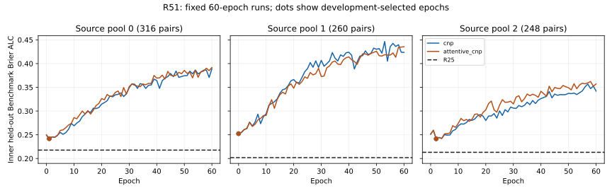
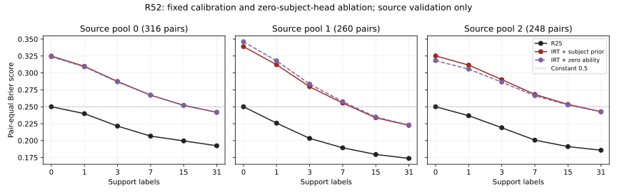

# 原文与代码复现：CNP / attention / amortized IRT

执行日期：2026-10-22。授权方案原文：[复现与组合](../doc/复现与组合.md)，保留原文。**R51、R52真实来源内实验均已完成，均未通过预声明进入条件；没有外层新成绩或模型组合。** ADeLe经用户明确回复等待资源。当前研究参照仍为R25，原0.005改善门槛尚未达到。

## 1. 已执行的方法与来源

全部检索使用 AnySearch；正式原文、补充材料和作者固定 commit 的代码构成方法依据。原始资产存于 `D:/nips-comp/paiec-dataset/reproduction_sources/`；URL、文件 hash、request ID 和代码位置见 [来源目录](../research_loop/literature/reproduction_v4/)。

| 本轮对象 | 原文与作者仓库 | 实际复现范围 |
|---|---|---|
| R51 CNP | [Garnelo et al., ICML 2018](https://proceedings.mlr.press/v80/garnelo18a.html)；[neural-processes](https://github.com/google-deepmind/neural-processes/tree/aca7e38ea64b718fbd7f311ccae5d51d73447d15) | context encoder、mean集合聚合、target decoder，Bernoulli输出 |
| R51 AttentiveCNP | [Kim et al., ICLR 2019](https://arxiv.org/abs/1901.05761)；同作者仓库 | deterministic target-to-context normalized dot-product attention；没有latent路径/ELBO，不能称为完整ANP |
| R52 Amortized IRT | [Truong et al., ICML 2025](https://proceedings.mlr.press/v267/truong25c.html)；[reeval](https://github.com/aims-foundations/reeval/tree/726cfe1ccedaa5576073665d9cda812d20a910c5) | 固定normal nuisance的difficulty校准，训练subject能力拟合，再加PAIEC合法特征冷启动适配 |
| Agent Psychometrics | [Ge et al., arXiv v2](https://arxiv.org/abs/2604.00594v2)；[作者代码](https://github.com/dariakryvosheieva/agent-psychometrics/tree/1c34d34a0ee82c92b1c63deb834495c5440bd362) | 原文/代码核对、能力分解及在线MAP参考；没有声称复现其完整SVI/agent实验 |
| ADeLe | [Nature正式论文](https://www.nature.com/articles/s41586-026-10303-2)；[作者代码](https://github.com/Kinds-of-Intelligence-CFI/ADeLe-AIEvaluation/tree/816321f327dfe66910b72b514156aaa296b15f00) | 主文/补充/rubrics/predictive_power核对；需求标注等待资源 |

与原论文的数值复现实验不同，本轮是**原作者核心机制的 PAIEC 迁移实验**：没有重跑原CNP的回归/图像任务，也没有执行旧TensorFlow1.13 notebook。核心方程由独立NumPy/作者公式 loss-gradient检查对齐。具体差异逐条记录在 [CNP/ANP映射](../research_loop/literature/reproduction_v4/cnp_anp.md) 和 [IRT映射](../research_loop/literature/reproduction_v4/amortized_irt.md)。

## 2. 评价范围与正确率含义

使用 R25 的三个 outer-training 来源池，每池再按 Benchmark 分为两个互斥方向，轮流训练/验证。来源 seed73、每Benchmark最多25 pairs，三个池分别316/260/248 pairs；它们包含重叠的历史公开来源，不能合计为824个独立新测试pair。R25按同一来源池重新回放，误差均小于5×10⁻¹²。

六预算为0/1/3/7/15/31；response在pair内部按原计数保留，pair之间等权。主指标Brier/ALC，越低越好。补充正确率是**预测某个subject response是否成功的二分类正确率**，阈值固定p≥0.5判成功；不是subject本身做题的正确率，也不是竞赛官方排名指标。正确率不能取代概率校准评分。

这里的来源内ALC不能直接与R31的5242-pair三种子ALC=0.195123926比较。只有来源内进入条件通过才运行外层。本轮未通过的候选不产生外层新成绩，旧R25参照和fallback不变。所有公开来源已被反复开发使用，early stopping产生的选中分数也是开发分数。

## 3. R51：真实训练结果

[评分前冻结协议](../research_loop/R51_protocol.md)；[完整summary](../paiec_baseline/runs/research_loop/R51/summary.json)。12次拟合全部完成60epochs，CPU4threads串行，总执行约559秒（含评价）；每epoch权重与history保留。没有因资源中止导致的假负结果。

| 来源池（pairs） | Smoothed2 ALC↓ | R25 ALC↓ | CNP ALC↓ | AttentiveCNP ALC↓ | 两模型选择epoch | 进入外层 |
|---|---:|---:|---:|---:|---:|---|
| 0（316） | 0.218989 | 0.217718 | 0.241731 | 0.241732 | 1 | 否 |
| 1（260） | 0.202870 | 0.201942 | 0.252388 | 0.252388 | 0 | 否 |
| 2（248） | 0.215042 | 0.213091 | 0.241483 | 0.241478 | 2 | 否 |

两模型同hidden width，但参数量102,913与148,097不同，不能把差异全归因于attention。所有来源池也未达到benchmark-equal增益。依据预声明stop rule，停止这两个配置；没有追加层数/宽度搜索、完整latent ANP或外层组合。

| 来源池 | R25 B31分类正确率 | CNP B31分类正确率 | AttentiveCNP B31分类正确率 |
|---|---:|---:|---:|
| 0 | 69.47% | 55.52% | 55.50% |
| 1 | 73.60% | 50.04% | 50.04% |
| 2 | 71.56% | 58.87% | 58.85% |

完整六预算正确率、Brier和ALC见 [CSV](reproduction_v4_metrics.csv) / [JSON](reproduction_v4_metrics.json)，逐pair结果在R51目录下 `fold*_selected_pair_scores.json`。



### 从结果能够支持的理解

**训练确实更新了模型，但当前跨Benchmark迁移失败。** 例如pool0 CNP两个方向的训练NLL分别从epoch1的0.647/0.663降至epoch60的0.310/0.252；其pooled验证ALC却从选中的0.241731升至0.389149。另两池epoch60为0.423581/0.342057，同样退化。因此“继续按相同设置延长训练就能解决”缺乏当前证据。

**选中的模型几乎没有利用支持标签与item的配对。** 四次label-only permutation对所选模型ALC的改变仅约10⁻⁹–10⁻⁷；B31预测概率平均绝对改变约0.6×10⁻⁶–5.8×10⁻⁶。数值上略好于置换不等于可用机制收益。这里限定于选中的epoch0/1/2，不能由此断言所有后期checkpoint均不使用配对。

**“目标形式像运行时任务”还不够。** 本轮已按六预算训练条件预测，但每方向仅114–168个固定source episodes，query与support轨迹没有跨epoch重采样；相比十万级参数，模型可能主要拟合source item/Benchmark相关性。这是与曲线一致的解释，尚非经过消融确定的因果结论。数据多样性、目标/先验捷径、训练配置以及原始表示仍是未分离的替代解释。

**先验误差依旧存在，加入attention没有自行消除。** 所选CNP三个池B0的pair均值偏差平方约0.0533/0.0844/0.0581，B31仍约0.0531/0.0844/0.0579。支持集没有充分纠正pair平均成功率；不能仅因模型可表示复杂条件函数，就认为它在小来源池中已经学会该函数。

结论范围：否定本轮被冻结的数据暴露量、特征和训练配置达到进入条件；未否定CNP/ANP家族、完整latent ANP、所有episode训练或PAIEC任务本身的可解性。

## 4. R52：原作者校准核心的结果

[冻结协议](../research_loop/R52_protocol.md)；[完整summary](../paiec_baseline/runs/research_loop/R52/summary.json)。六次LBFGS拟合全部达到梯度infinity norm≤1e-5，分别36/21/19/21/16/17次outer iterations；没有触发100次或1800秒上限。拟合总计约147秒，整轮含评价约361秒。没有利用validation选择epoch或参数。

| 来源池 | IRT B0 Brier↓ | 恒定0.5 B0 | IRT B1 Brier↓ | R25 B1↓ | B0优于0.25的Benchmark | IRT ALC↓ | 进入外层 |
|---|---:|---:|---:|---:|---:|---:|---|
| 0 | 0.324895 | 0.250000 | 0.309754 | 0.239822 | 6/26 | 0.279952 | 否 |
| 1 | 0.338935 | 0.250000 | 0.312087 | 0.225789 | 4/23 | 0.272317 | 否 |
| 2 | 0.325168 | 0.250000 | 0.311541 | 0.236760 | 3/23 | 0.281483 | 否 |

全部pool的B0、Benchmark多数方向、B1 pair-equal和B1 benchmark-equal条件均失败。全六预算也未胜R25。停止该primary配置及以其成功为前提的多维IRT/MoE扩容；没有把零能力消融事后改为新primary，也没有混入R25。

| 来源池 | IRT B0分类正确率 | IRT B1分类正确率 | IRT B31分类正确率 | R25 B31分类正确率 | 零能力消融B0 Brier↓ |
|---|---:|---:|---:|---:|---:|
| 0 | 54.10% | 55.96% | 64.45% | 69.47% | 0.323983 |
| 1 | 48.12% | 52.87% | 67.35% | 73.60% | 0.346089 |
| 2 | 53.38% | 54.65% | 65.24% | 71.56% | 0.318191 |



### 从结果能够支持的理解

**能力/难度分离没有自动保证跨Benchmark对齐。** 去掉整个subject能力头，B0仍为0.3240/0.3461/0.3182，全部差于0.25。因此失败不能只归咎于subject哈希回归；内容difficulty及其校准/迁移同样需要检验。这不是对原论文使用Llama特征、FLOPs或已知subject设置的否定。

**标签更新改善了平均成功率，却没有形成可靠的item区分。** Brier有精确分解：`Var(Y) + (mean(P)-mean(Y))² + Var(P) - 2Cov(P,Y)`，这里按原response计数加权。R52在pool0的pair均值偏差平方从B0的0.09448降到B31的0.01227；但B31预测方差0.04490，仅得到0.00343的协方差抵消。pool1/2的B31预测方差为0.04022/0.05019，协方差项分别+0.00220/−0.00172。也就是说，当前difficulty产生了较多未被正确响应对应关系支持的概率差异。`Var(Y)`是本评价池的边际响应方差，不能称为不可约噪声下界。

**Rasch的在线修正能力有结构限制。** 当前支持标签只更新一个theta，所有query的logit共同平移，item排序仍由冻结difficulty决定。label-only permutation在保存的所有pair/预算上预测差异均为0，与充分统计量性质一致；它不是模型忽略标签的证据。这一性质也解释了为什么增加支持标签主要改善均值，却不能重新学习局部item对应关系。

**优化收敛和模型可迁移是不同证据。** 本轮严格收敛排除了“只是没跑完”这一解释，但线性difficulty、MiniLM特征、有限source episodes、fixed-normal目标与subject适配仍共同限定结论范围。没有通过独立消融证明其中哪一项是唯一原因，不能扩大为所有amortized IRT无效。

原文核对还纠正了推荐前提：reeval发布代码是expected-NLL，不是log-marginal；Agent Psychometrics的新agent是已见LLM与已见scaffold的新组合，不能当作任意subject零标签冷启动的已有证明。

## 5. 本轮形成的判断与停止点

1. **CNP/attention与IRT呈现不同失败方式。** CNP选中的早期模型几乎不利用支持标签配对；IRT能通过支持标签校正平均能力，但保留了不可靠的item差异。不能把两者合并成“所有模型都没有信息”这一结论。
2. **可迁移表示和条件学习都需要直接证据。** 架构与任务形式贴合、源训练loss下降、原论文有效，都不能代替当前Benchmark隔离下的增益。现有结果支持停止本轮配置，不支持继续扩大相同模型或扫描混合权重。
3. **目前没有应当组合的独立收益。** R51/R52均未通过source gate，因而没有运行5242-pair三种子外层、额外Bootstrap或提交包替换。此前R25=0.195123926与冻结参照0.198687363属于另一评价范围，保持原记录。
4. **ADeLe等待资源。** 用户明确选择先完成CNP/IRT。已核对原文/rubric，并从合法training来源准备128个distinct items×4原始维度=512个请求，未调用API、未生成需求标签、未训练。输入准备见 [R53记录](../research_loop/R53_annotation_feasibility.md)；原文和限制见 [ADeLe记录](../research_loop/literature/reproduction_v4/adele.md)。需求judge接受较长canonical文本，未来必须披露与MiniLM token窗口的差异。资源就绪后先验证标注一致性、成本和隐藏推理可用性，再冻结效果实验。

## 6. 工件与复现入口

- 总合同：[REPRODUCTION_V4_SPEC](../research_loop/REPRODUCTION_V4_SPEC.md)。
- 共同数据与评价：`paiec_baseline/mlp/reproduction_episodes.py`、`reproduction_training.py`。
- 模型：`neural_process.py`、`amortized_irt.py`；round driver 位于 `mlp/run/`。
- 原始配置、依赖SHA256与代码快照：`paiec_baseline/runs/research_loop/R51/` 与后续R52目录。
- 来源内指标与分析表：[CSV](reproduction_v4_metrics.csv)、[JSON](reproduction_v4_metrics.json)；图由 `mlp.reporting.reproduction_v4_report` 生成。
- 每epoch `.pt` 是本机实际权重，位于对应run目录；Git忽略权重，克隆仓库不自动带这些文件。外部数据/缓存同样需保留或重建。
- 环境、依赖版本及750个本地权重/固定nuisance文件的SHA256：[execution_inventory.json](../paiec_baseline/runs/research_loop/reproduction_v4/execution_inventory.json)。起点commit `fd5b06df51233392ea9d482732af8063f4222ec1`；各run另外保存本次未提交源码的精确SHA256和快照，不能仅凭起点commit复现新增方法。
- [实现验证和单一独立合同复核记录](../research_loop/reproduction_v4_validation.md)：28项合并检查通过；来源核对、实现检查、真实效果证据各自保留边界。R51/R52共18次真实拟合完整完成；当前没有后台训练进程。

在 `D:/nips-comp/nips-comp/paiec_baseline` 下运行：

```powershell
& D:\nips-comp\paiec-runtime-win64-py312-cpu\python.ps1 -m mlp.reproduction_episodes --prepare
& D:\nips-comp\paiec-runtime-win64-py312-cpu\python.ps1 -m mlp.run.run_neural_process_round
& D:\nips-comp\paiec-runtime-win64-py312-cpu\python.ps1 -m mlp.run.run_amortized_irt_round
& D:\nips-comp\paiec-runtime-win64-py312-cpu\python.ps1 -m mlp.reporting.reproduction_v4_report
& D:\nips-comp\paiec-runtime-win64-py312-cpu\python.ps1 -m mlp.reporting.reproduction_v4_inventory
```

已完成的run会依据provenance/fit contract复用，不会悄悄覆盖为不同代码实验。需要真正重新训练时使用新的 `--out` 目录；不要删除历史证据。
