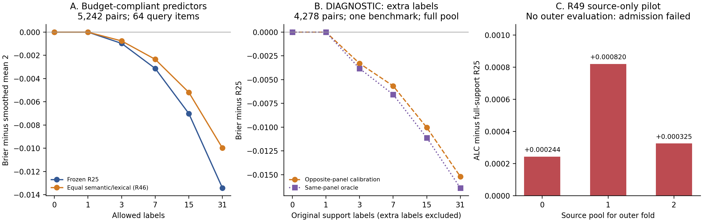

# Loop v3：当前证据、方法决策与阻碍

2026-10-22；控制文件为`doc/loop_2.md`及四份参考材料。延续R1–R31，已完成R32–R50的实验/审计。**研究Success Gate仍未达到；这里是实际断点，不是研究目标已完成的声明。**

## 1. 当前可比较的方法

以下均为5242个公开subject–benchmark pair、三个原item split种子、每pair至多64个evaluation items，保留其全部responses，pair等权ALC。公开benchmark已反复用于开发，不是新盲测。

| 方法 | ALC↓ | 结论 |
|---|---:|---|
| Smoothed mean strength2 | 0.198687363 | 冻结参照与已打包fallback |
| R25局部语义+metadata | 0.195123926 | 相对参照改善0.003563437；不足0.005 |
| R34支持标签LOO幅度 | 0.195075364 | 仅比R25低0.000048562；新增差异聚类区间跨零，未晋级 |
| R39匹配曲率Bernoulli | 0.195129601 | 未改善R25；停止loss/link变体 |
| R46固定语义/词法平均 | 0.196033067 | pair主指标退化，即使23/36benchmark及BM等权改善也未晋级 |

R25仍是较充分复核的研究参照。尚无新的方法满足冻结晋级标准。原fallback文件哈希保持不变：`E55EE0B267F3B345685EF072CFA511C3C017D9082256573793961EA20FEADCB9`。没有正式提交Codabench，也没有宣称R25已有新提交ZIP。

## 2. 高层认识发生了什么变化

**测量不足以解释差距。** R32的分层完整query对照与主导benchmark全4278pair复核，没有发现去除64-item上限能补上剩余差距。分层外推不是全5242pair的完整评分；主导benchmark全量结果也不能冒充全benchmark结果。重复响应方差在两个固定预测器的Brier差异中抵消，不能把所有未达标归因于随机响应噪声。

**方向信息与可估计幅度是两个问题。** R33用评价标签拟合的幅度oracle显示潜在空间。R48将拟合和评分放到不相交的评价item面板后，这个空间部分保留：capped诊断0.191438453；完整主导benchmark诊断0.185349420，对应R25为0.190666939。因此不能说全部空间都是同样本拟合假象。但capped跨benchmark比较有一折退化、聚类区间跨零。跨面板方法还使用额外评价标签，**不符合比赛标签预算，不能作为提交成绩或过Gate证据**。两种oracle的差距同时包含面板大小/估计方差变化，不是纯乐观偏差的精确分解。

**现有31标签内的实现尚不能稳定利用这部分空间。** R34的支持集LOO幅度、R43的query条件可靠性MLP、R49的方向/校准标签分割都未形成稳健增益。R43真实训练、权重导出与NumPy一致性已完成，但三组内层中的两组选择epoch0。R49三来源ALC分别比R25高0.000244、0.000820、0.000325；其来源进入条件失败，未运行外层。不能把这些失败推论为所有少样本方法都不可能成功。

**增加表面复杂度目前没有证据依据。** R37分区先验、R39链接函数、R40输入分组、R42支持模板去除、R44方差分配、R46等权组合均有明确控制与退出依据。它们分别否定当前设计，不是对整类贝叶斯方法、非线性模型或集成学习的普遍否定。

**仍有信息边界需要外部事实。** R50只有emoji_attack的10/5242pair存在非空且变化的interactors。只修复这10pair时，即使其误差全部归零，整体最多增益0.000403392，低于剩余0.001436563，因此不优先开发该字段编码。R47确认公开图片资产存在，但当前公开predict字段未明确提供资源解析/挂载契约。训练资产可下载不等于隐藏推理可访问像素。

## 3. 当前阻碍与后续进入条件

最高优先的信息扩展分支是核实多模态运行时契约，再决定是否建立像素对照。公开Codabench起始包页面/API在requests（www与非www）均返回TLS unexpected EOF；Windows原生curl也握手失败；web和AnySearch远程提取同样未取得页面。未关闭TLS验证、未访问私有数据、未发送组织者消息。AnySearch返回了服务端提取错误及request_id，这是特定URL提取失败，不能写成AnySearch API整体失联。

当前HF revision与本地固定revision一致，没有发现可作为新独立验证来源的版本更新。所有现有公开集复用带来的选择偏差继续保留。

后续进入条件：取得明确的公开资产运行时说明或可访问的起始包，再设计保持相同标签/分割/求解器的text-versus-pixel对照。此前不下载大图像编码器，不依靠相对路径猜测隐藏资产，也不回到已否定的幅度、分割、混合系数或协方差网格。该接口阻碍仅限制像素分支，不是证明其他算法不存在。当前没有后台实验任务。

## 4. 实际产物与复现

- [每轮六字段证据与决策](../research_loop/ITERATION_V3.md)
- [实际复现命令](research_loop_v3_reproduction.md)
- [当前高层状态](../research_loop/HIGH_LEVEL_STATE.md)
- [研究算子记录](../research_loop/OPERATOR_LEDGER.md)
- 真实评分、逐pair/预算CSV、配置、协议及源码哈希：`runs/research_loop/R32/`至`R50/`；不要重跑仍标记过历史running但已有summary的轮次。
- R48相关数值/隔离测试7项通过；R49两项通过。此前全tools回归为90项通过，之后另有各模块测试；这里不把它们声称为一次新的全套测试通过。
- [对比图PDF](figures/v3_oracle_transfer.pdf)：明确分开合法预测、额外标签诊断、来源内pilot。

官网接口与资源依据：[PAIEC官方规范](https://aims.stanford.edu/competition)、[measurement-db](https://huggingface.co/datasets/aims-foundations/measurement-db)。外部理论的适用范围及迁移推论分别记录在`research_loop/literature/v3_*.md`；没有将论文结果当作本项目的性能证据。
