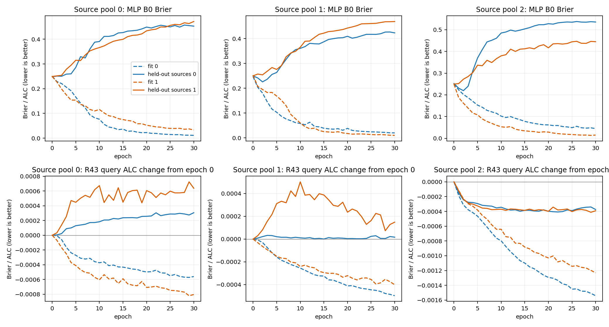
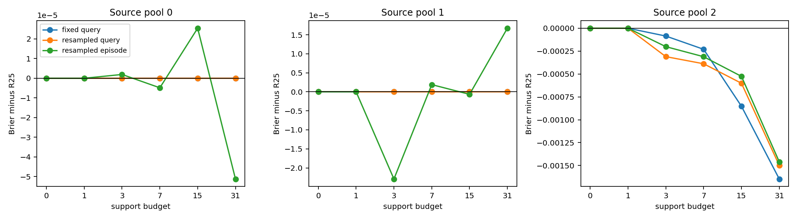
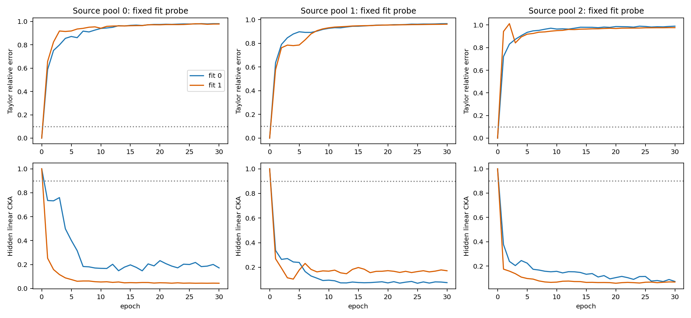

# plan_2 五候选：实验结果与机制认识

记录日期：2026-10-22。用户原文 `doc/plan_2.md` 保持原样。下述均为实际执行记录；条件未满足的实验单列，不算作已训练负结果。

## 1. 执行结果

| 候选 | 执行量 / 条件 | 来源内结果 |
| --- | --- | --- |
| 1 / R54 完整轨迹 | 18 fits × 30 epochs | MLP 3/3来源池双方向满足过拟合停止条件；无预定义延迟恢复 |
| 2 / R55 支持集重采样 | 12 fits × 20 epochs；4次预算内标签置换 | 通过来源进入条件 0/3 |
| 3 / R56 Benchmark风险 | 6 fits × 30 epochs；λ=.5 | 通过来源进入条件 0/3 |
| 4 / R57 平均 | R43参数EMA/SWA和最终概率平均 | R43全部方法0/3通过；MLP无稳定窗口，未执行平均 |
| 5 / R58 初始化 | 触发来源池 0/3，要求≥2 | condition_not_met；新增fit 0 |

当前这组来源试验没有提供满足全体来源条件的新方案；没有执行新的5242-pair外层评分、组合或替换提交fallback。原R25的5242pairs×3seeds代理ALC 0.195123926及冻结均值0.198687363是历史总体结果，不能与下表不同来源池的数字直接比较。

## 2. 比较协议和主要分数

三个source pools分别316/260/248 pairs，沿用R25来源池及R43 Benchmark互斥二分，各拟合两个方向。池之间有重叠，不是三次独立盲测。每Benchmark最多25pairs、固定seed73、最多64query items，重复responses保留；预算0/1/3/7/15/31，ALC权重.1/.2/.2/.2/.2/.1。

普通MLP用历史2048→128→64→1、每Benchmark最多400行、AdamW/Brier/residual-strength2；R43保持16→16→8→1、原16统计、g约束与0.01(g−1)²。MLP初始化seed2026，R43为4307；这是单初始化pilot，未完成新方法的多训练seed稳健性验收。来源选择使用B0（MLP）或ALC（R43），outer不参与。

| 来源内 pair-equal ALC ↓ | 池0 | 池1 | 池2 |
| --- | --- | --- | --- |
| R25 | 0.217717579 | 0.201941920 | 0.213091212 |
| smoothed_mean_2 | 0.218989098 | 0.202870365 | 0.215042166 |
| training_selected_smoothed | 0.218989098 | 0.202870365 | 0.214730971 |
| mlp_best30 | 0.219226222 | 0.200704065 | 0.213980139 |
| query_best20 | 0.217717579 | 0.201941920 | 0.212692841 |
| resampled_query | 0.217717579 | 0.201941920 | 0.212681380 |
| resampled_episode | 0.217716959 | 0.201939253 | 0.212737579 |
| benchmark_mixture | 0.219237254 | 0.200425165 | 0.213249964 |

`best30`表示在epochs1–30中按来源B0选择MLP checkpoint，`best20`表示在epochs0–20中按来源ALC选择R43 checkpoint，并非固定取epoch30/20。完整patience、同停止步数最佳、固定20/30等规则在指标表分别列出。

六预算Brier及固定p≥0.5的成功预测正确率全部在 [metrics.csv](training_mechanism_v5_metrics.csv)；逐Benchmark结果在 [benchmark_metrics.csv](training_mechanism_v5_benchmark_metrics.csv)。这里的正确率是预测器是否判对subject响应成败，不是subject本身的答题正确率；ALC也不是accuracy。

## 3. 候选1：训练确实继续，但普通MLP泛化持续变差

| 来源池 | 最佳来源epoch | 最佳B0 Brier | epoch30 B0 Brier | 最佳B0预测正确率 | 最佳B31预测正确率 |
| --- | --- | --- | --- | --- | --- |
| 0 | 1 | 0.251459 | 0.461819 | 51.67% | 68.71% |
| 1 | 2 | 0.238249 | 0.443506 | 57.50% | 73.45% |
| 2 | 1 | 0.241876 | 0.487452 | 56.88% | 70.11% |

每个池的两块互斥来源验证组均符合冻结停止条件：epochs21–30训练误差低于epochs1–5，来源验证比早停最佳恶化，且没有连续3epochs恢复≥.001。因此停止本配置的延迟泛化/长Grokking搜索；这不证明任意更长训练或其他任务都不能grok。

R43 query的best≤20与best≤30均为0/0/20，episode-only均为0/0/9；没有晚于原20epochs的新最优选择。**R43历史是固定20epochs+合并曲线argmin，新增patience5只是反事实对照**；不得解释为历史R43被早停截断。



## 4. 候选2：不同支持集是否让条件修正获得增量

每epoch在相同合法pair的完整题池抽取新support/query，seed5501–5520；保持每pair query行数、四档预算、初始化、更新次数和fit参考标准化相同。固定组复用R54前20epochs。B0/B1按构造保持相同。

| 来源池 | 重采样query所选epoch | 相对R25 ΔALC | 相对固定query ΔALC | 相对重采样episode-only ΔALC | 置换净差分 |
| --- | --- | --- | --- | --- | --- |
| 0 | 0 | -0.000000000 | +0.000000000 | +0.000000620 | +0.000000000 |
| 1 | 0 | -0.000000000 | +0.000000000 | +0.000002666 | +0.000000000 |
| 2 | 17 | -0.000409832 | -0.000011461 | -0.000056199 | +0.000767869 |

置换净差分是 `(model−R25)_真实 − mean(model−R25)_置换`，负值才支持模型增量依赖正确支持关系；每个预算内只置换已观察标签，重算d和全部统计，并同步评价置换R25。四次原始结果和逐pair分数均保留。选回epoch0时净差分为0，只说明本配置未获可采用的学习增量，不能据此否定R25已有局部对应信号。

第三池相对固定query虽有约1.15e-5的局部改善，但置换净差分为正（约7.68e-4）：修正在错误对应关系下相对R25反而获益更多。一个与数据相容的解释是学到了幅度收缩/降噪，而非新增可迁移的题目对应信息；这仍是解释假设，不能从置换试验直接断言网络完全忽略标签。



## 5. 候选3：风险权重改变了什么

| 来源池 | 所选epoch | 相对pair风险 ΔALC | 相对R25 ΔALC | Benchmark-equal相对pair风险 |
| --- | --- | --- | --- | --- |
| 0 | 1 | +0.000011031 | +0.001519675 | +0.000469100 |
| 1 | 2 | -0.000278900 | -0.001516755 | -0.000125866 |
| 2 | 1 | -0.000730175 | +0.000158752 | -0.000270698 |

风险为pair和Benchmark两级平均的固定.5混合；不是GroupDRO的动态minimax。Benchmark风险质量保存在各fit的risk_audit.json；完整fit初始化梯度对比如下。没有额外抽样或搜索λ。

| 来源池/方向 | 梯度cosine | 混合/pair梯度norm |
| --- | --- | --- |
| 0/0 | 0.885988 | 0.749284 |
| 0/1 | 0.967748 | 1.532317 |
| 1/0 | 0.986897 | 0.549072 |
| 1/1 | 0.977574 | 0.795389 |
| 2/0 | 0.982318 | 0.894899 |
| 2/1 | 0.928132 | 0.770431 |

只有Benchmark-equal改善不能抵消真实pair-equal计分退化。本轮权重调整确实改变了有效梯度，但没有得到跨三个来源池一致的计分收益；是否能促成更可迁移的特征仍需额外证据。

## 6. 候选4与5：条件进入与停止

MLP三个来源池均无符合合同的3epoch稳定窗口，因此未对MLP强行平均。R43 query/episode均使用最早窗口[1,2,3]；对照包括best≤30、窗口内最佳单一权重，EMA=.9、SWA和三个checkpoint最终预算概率平均。没有新增训练更新。

| 平均方法 | 池0 ΔALC vs最佳单一 | 池1 ΔALC | 池2 ΔALC | 通过池数 |
| --- | --- | --- | --- | --- |
| query/ema | +0.000027746 | +0.000023967 | +0.000239326 | 0 |
| query/swa | +0.000068167 | +0.000043754 | +0.000178541 | 0 |
| query/probability_average | +0.000082058 | +0.000048892 | +0.000170930 | 0 |
| episode/ema | +0.000019053 | +0.000019716 | +0.000169568 | 0 |
| episode/swa | +0.000048948 | +0.000034396 | +0.000106129 | 0 |
| episode/probability_average | +0.000059423 | +0.000037752 | +0.000096450 | 0 |

参数平均部署仍是单模型；概率平均需三个checkpoint的前向计算，此处未测Hosted端到端延迟。它是短窗口平均核心迁移，不是SWAD逐iteration密集loss-valley完整复现。

初始化诊断：MLP六个方向epochs1–10的Taylor相对误差中位数范围0.808–0.941，hidden CKA中位数范围0.069–0.359，均不符合“长期接近初始化线性函数”的预声明条件；后期也无所需稳定来源增益。因此R58未触发，没有执行输出层尺度、学习率或weight-decay扫描。**未触发不等于已经证明改变初始化无效。**



## 7. 对问题本身的认识

1. **普通MLP早期已经改变表示，随后出现强烈的来源外退化。** 它很早就明显偏离初始化的一阶近似，训练拟合持续提高，来源外概率质量却显著变差。这与学习了来源特有相关性的解释一致，但本试验没有确定具体哪些特征造成退化。表示变化本身不能证明可迁移信息增加。

2. **固定episode不是能够单独解释全部失败的原因。** 重采样是针对这一假设的单因素干预；应以相对R25、固定query及episode-only的共同结果解释，不能仅凭训练loss变好就宣称学会了题目对应关系。当前配置的进入条件未成立，继续加宽网络或扫描支持集策略缺少本轮证据。

3. **稳定的来源窗口没有带来稳定的平均收益。** 留下全部checkpoint消除了“未观察后期”的缺口；早期验证平稳也不自动意味着平均后来源外更好。源内选择仍有自适应偏差。

4. **pair目标与Benchmark目标必须分开报告。** 群组重权和较公平的来源覆盖是可检验干预，不是成绩提升的充分条件。最终判据仍是同一pair-equal Brier ALC及强均值/R25对照。

5. **负结果的范围是已运行配置。** 本轮没有证明所有条件模型、所有初始化或所有表示学习都失败。已有证据更支持保留R25局部证据基线；新的计算投入需要新增输入结构、可靠冷启动信号或独立数据依据，不能把文献中的机制直接当成本任务的收益承诺。

## 8. 文件、来源和复现入口

| 文件 | 用途 |
| --- | --- |
| `doc/plan_2.md` | 用户五候选完整原文 |
| `research_loop/TRAINING_MECHANISM_V5_SPEC.md` / `...ERRATA.md` | 冻结参数、进入/停止条件及历史名称澄清 |
| `research_loop/literature/training_mechanism_v5.md` / `...sources.json` | AnySearch记录、原文定位、作者仓库commit、PDF SHA256、代码公开缺口 |
| `reports/training_mechanism_v5_metrics.csv/json` | 全部选择规则、六预算Brier、ALC和分类正确率 |
| `reports/training_mechanism_v5_benchmark_metrics.csv` | 逐Benchmark增减 |
| `paiec_baseline/runs/research_loop/training_mechanism_v5/R54–R58/` | 真实fit、epoch权重、逐pair指标、选择及置换、触发审计 |
| 同run根的`environment.json` / `core_provenance.json` / `stage_contracts` | 环境、实际源文件与分组版本、阶段复用约束 |
| 同run根的`implementation_audit.json` / `result_audit.json` / `execution_inventory.json` | 数值核对、匹配对照审计、产物SHA256 |
| `research_loop/training_mechanism_v5_validation.md` | 单个只读结构复核、修正与剩余证据边界 |

命令在 `paiec_baseline` 运行：

```powershell
powershell -NoProfile -ExecutionPolicy Bypass -File D:/nips-comp/paiec-runtime-win64-py312-cpu/python.ps1 -m mlp.run.run_training_mechanism_round trajectory
# 其后按顺序把 trajectory 替换为 resample、benchmark_risk、averages、initialization
powershell -NoProfile -ExecutionPolicy Bypass -File D:/nips-comp/paiec-runtime-win64-py312-cpu/python.ps1 -m mlp.run.audit_training_mechanism_results
powershell -NoProfile -ExecutionPolicy Bypass -File D:/nips-comp/paiec-runtime-win64-py312-cpu/python.ps1 -m mlp.run.report_training_mechanism
```

缺失向量准备入口为 `mlp.run.prepare_training_mechanism_cache`，只用已迁移本地MiniLM。已完成结果会检查源码与输入hash后复用；源码变化必须创建新实验版本，不能混用旧选择。NPZ权重与外部缓存是本地产物，Git忽略不等于已随仓库分发。

文献严格区分：Kumar/DomainBed/CNP/GroupDRO/SWAD/Kaddour/Woodworth提供机制和方法依据；2026谱理论仍为预印本，代码声明待公开，且齐次网络/耦合L2条件不覆盖本任务的bias+sigmoid+AdamW。详见来源表，不将本轮说成七篇论文原始成绩的完整复现。

## 9. 计算、异常与证据边界

实际完成 36 个fit，保存 996 个epoch checkpoint；fit记录耗时合计 303.5 秒，最长单fit 23.5 秒（均<1800秒）。此数不含抽样、特征准备、置换和文献整理。CPU为Ryzen7 4800H，Torch2.9.1+cpu，4threads，训练串行。

重采样新增本地MiniLM向量 19138 条，预处理记录 607.5 秒。首次R55准备因缺缓存退出，尚未拟合；失败留在execution_attempts。补算保留原token截取规则；PowerShell曾把Tokenizer截断前长序列提示包装为NativeCommandError，Python仍写出完整准备记录，后续全部新episode能读取向量。

完整轨迹只覆盖30epochs；训练初始化各一个seed。四个置换seed不等于四个训练seed。来源池重复使用、跨池重叠、checkpoint选择均限制结论强度；没有独立未见Benchmark盲测、隐藏测试或新正式提交。原0.005 Research Gate仍未通过。ADeLe继续按用户决定等待资源。
