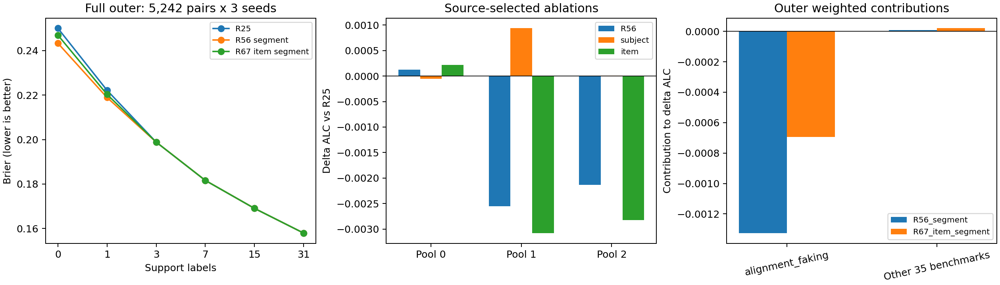

# PAIEC R65–R68：低预算先验的信息来源与迁移边界

日期：2026-10-22。控制原文：[plan_5.md](../doc/plan_5.md)。**R65诊断、R66消融、R67完整外层、R68可行性审计均已执行。新增15次fit；R67实际评价5242pairs×3item-split seeds×6预算，未通过研究晋级。** R25、R56_segment探索记录和fallback保留，未正式提交。

## 1. Executive Judgment

**目前最明确的机制认识：合法item字段可以承载低预算概率均值信息，显式subject描述不是保留这部分信号的必要条件；但这份信息的跨Benchmark可靠性仍未建立。** item-only在来源隔离消融中优于subject-only，并在两池优于原full R56；因此按评分前条件进入R67。完整外层却弱于R56_segment，仍有一折退化、Benchmark等权退化、聚类CI跨零和主导Benchmark集中。

这支持停止继续微调当前MLP的门控、权重、架构。下一步优先解决**新增任务需求信息的可得性**，或**当前跨subject证据的真实运行时合同**。不能把这轮结论扩大成所有历史先验无效，也不能把item-only写成已解决跨域泛化。

主要入口：[完整Brier/正确率表](transferable_prior_tables.md)、[指标CSV](transferable_prior_metrics.csv)、[逐Benchmark CSV](transferable_prior_benchmark_metrics.csv)、[复现与审计](transferable_prior_reproduction.md)、[实验合同](../research_loop/TRANSFERABLE_PRIOR_SPEC.md)、[决策](../research_loop/TRANSFERABLE_PRIOR_DECISION.md)、[原文及作者源码](../research_loop/literature/transferable_prior_mechanism.md)。

## 2. Observed Phenomenon

R65直接读取R62已冻结的逐variant概率、support/query身份、response计数和训练来源；没有重新抽样。正式比较保持pair等权，pair内保留重复response权重，原64-query-item上限及六预算。以下是公开开发代理评价，不是隐藏测试。

| 完整外层方法 | pair ALC↓ | Benchmark等权ALC↓ | B0 Brier↓ | B1 Brier↓ |
|---|---:|---:|---:|---:|
| smoothed mean 2 | 0.198687363 | 0.214868900 | 0.250000000 | 0.222119481 |
| 训练来源选择的mean | 0.201101132 | 0.214728460 | 0.250000000 | 0.226714877 |
| R25 | 0.195123926 | 0.212920227 | 0.250000000 | 0.222119481 |
| R56_segment（历史） | **0.193805399** | 0.215241395 | 0.243287225 | 0.218883231 |
| R67_item_segment（本轮） | 0.194448914 | 0.213663432 | 0.246918105 | 0.220285370 |

R67的B0/B1预测正确率为**57.8451% / 66.7012%**；R25为43.0466% / 66.6975%；R56为58.2554% / 66.7046%。正确率按`p≥.5`预测二元response，R25 B0全部等于.5，受tie约定影响；它不是ALC，也不是被评subject本身的正确率。历史R16已提示不同任务的原始1标签不一定对应同一种“能力成功”，本轮保留官方公开二元response，不重新定义标签。

## 3. Competing Explanations

| 假设 | 本轮判别 | 证据边界 |
|---|---|---|
| H1 subject prior | 匹配subject-only未稳定改善；item-only可保留部分外层收益 | 显式subject字段不是这些收益的必要条件；interactors仍可能间接包含系统设置，不能证明所有subject信息无效 |
| H2 item-distribution prior | 来源两池item-only优于full和常数，外层B0/B1有小幅收益 | 支持item字段条件化的均值信息；未证明是通用任务难度，更未证明跨Benchmark可靠 |
| H3 subject–item interaction | full并非来源最优，item-only仍有信号 | 当前证据不需要“必须非加性交互”的解释；不能从消融排名单独识别或否定所有交互 |
| H4 prevalence matching | 主要收益集中、负迁移强、合法低维距离关联反转 | 相容于来源模式与目标prevalence偶然/局部匹配；不是唯一已证实原因 |
| H5 risk weighting/calibration | R54/R56使用相同输入，风险变化主要改善pair均值误差 | 是概率映射变化证据；mean-bias平方不是完整校准测度，不能据此宣称学到了独立信息源 |

## 4. Discriminating Evidence

### R65：均值、逐题变化和首标签更新

使用response加权恒等式`Brier=Var(Y)+(mean(P)−mean(Y))²+Var(P)−2Cov(P,Y)`。R56分段相对R25的均值项贡献−0.001288446、pair内变化项−0.000030082，约97.7%净改善来自均值项。这不是跨训练样本的bias–variance估计，也不能把Var(Y)视为不可约噪声。

**B1收益主要继承较好的B0先验，首标签并没有进一步扩大相对优势。** R56 B0−R25 B0为−0.006712775；两者分别获得首标签后的更新差为+0.003476526，相加得到B1差−0.003236249。这里只比较同一query总体的两次预测，不进行目标标签门控。在alignment上同样缩小优势；其他35BM的B0/B1差分别+0.000103266/+0.000155247，均略退化。

**不是简单复制全训练来源均值。** 只用合法fit样本的mixture加权常数，B0/B1为0.251947015/0.223000013，弱于R56。总体平均预测R54=.322062、R56=.385996、来源常数=.507462，目标response均值=.430466。这个对照排除了“等于一个全来源常数”的充分解释，不能排除更细的内容相关来源模式。

**相似输入统计尚不能判断可靠性。** 使用subject字段结构、item长度/字符结构/metadata长度、冻结MiniLM前4坐标及范数、原预测不确定度和首支持误差作离线描述。来源统计只由fit样本拟合。来源标准化距离与B0相对风险的BM等权Spearman三折为−.164/+.412/−.275；subject名称曾见与否也反转。全部信号见`R65/descriptor_v2/benchmark_correlations.csv`。这些只是预定少量统计，不能证明不存在其他可靠性特征。

典型反例：enginemt_qa平均预测.3806而观察率.8177；benger .3948对.8288；appworld .6139对.2532；healthadminbench .5777对.2458。相同“低概率”方向既可能在alignment获益，也可能在另一些任务严重低估。整组query汇总仅用于本段离线诊断，没有进入R67。

### R66：从训练开始删除信息组

历史A1 subject-only、R15/R16能力标量和R52 IRT均不严格等价。本轮新训subject-only与item-only各6次，原R56 full六条30epoch轨迹直接复用。保持同一采样行、数据顺序、mixture风险、2048→128→64→1容量、seed2026、AdamW、batch256、30epochs及内层Benchmark隔离选择规则；原full编码、更新数和初始化逐项一致。

| 来源分段ΔALC对R25（负值好） | 池0 | 池1 | 池2 |
|---|---:|---:|---:|
| R56 full输入 | +0.000127949 | −0.002550145 | −0.002129535 |
| subject-only | −0.000051779 | +0.000936464 | +0.000009019 |
| item-only | +0.000218970 | **−0.003078693** | **−0.002826517** |
| fit-only常数 | +0.000192353 | +0.001505560 | −0.000123557 |

subject选epoch `[2,1,1]`，item `[1,2,2]`；完整轨迹仍显示来源拟合改善不能保证未见来源改善。item通过事前探索条件，subject未通过。来源池共有824次pair暴露、412不同pairs，池间重叠；内层验证参与checkpoint选择，因此这些是来源选择证据。R66不足以证明R56在alignment上的收益具体由哪一类item属性造成，也未将metadata/interactors再拆成网格。

### R67：来源正面信号能否保持到外层

仅refit一个来源选定item分段候选，完整5242pair×3seed已执行。R67相对R25 ΔALC=−0.000675012，三fold为`−0.002006163 / +0.000489853 / −0.000653691`，BM-cluster95%CI=`[−0.002128034,+0.003252206]`；BM等权退化+0.000743205。

alignment贡献−0.000695427，其余35BM合计+0.000020415；其余BM条件平均退化+0.000111012。最大BM回归abstract_reason +0.020544337，17/36BM改善。R67比R56_segment退化0.000643516，虽BM等权较R56好0.001577964，不能替换pair主指标宣称胜出。

## 5. High-Level Understanding

1. **有用的均值信息不等于稳定能力测量。** 输入条件化确实超出全来源常数；但同样的表示在不同来源上会对应不同成功率，单一任务成功概率不能直接解释为通用subject能力。
2. **信息是否存在、由哪些字段表达、是否能迁移，是三个不同问题。** R66回答字段是否足够保留来源信号；R67显示这个答案并不保证外层排名保持。没有一个消融数字能替代三层证据。
3. **有限标签更新和先验选择承担不同任务。** 首标签改善两者的概率，但对R25改善更多；不能据“有标签”就推断可准确判断哪个先验更可靠。R61负结果仍成立。
4. **更简单的机制可以增加理解，即使没有更低总分。** 删除显式subject字段仍保留R67的部分收益，削弱了“必须复杂能力交互”的解释；它同时暴露了内容相关先验的迁移限制。full更优也可能来自可加信息、哈希碰撞或优化，不能自动叫交互。
5. **研究需要匹配部署可观测量。** query组均值、目标成功率、Benchmark名称都未进入预测器；推理缓存只是相同合法input的逐行计算复用。新增任务需求特征或共享标签只有实际可得，才构成新信息。

## 6. Minimal Method Design

R67唯一方法为item-only MLP：`B0=q`，`B1=clip(q+(y0−p0)/3,0,1)`，B3–31沿用R25。`q/p0`分别来自query与首支持item的三个合法字段，不需要整组query，未训练可靠性网络或重扫融合系数。来源选epoch后在完整合法来源refit3次。

它是由R66证据触发的探索实现，未达到作为新可靠prior的研究要求。本轮没有再根据R67负结果增加选择器，也没有构建依赖跨调用状态的模型。

## 7. Evaluation and Decision

R67相对smoothed2改善0.004238448，未达0.005；相对training-selected mean改善0.006652218，但两种比较的cluster CI均跨零。对R25的一折/BM退化及集中风险也独立存在。因此**未晋级，不自动采用或提交**。完整分数、每seed、各基线差异及CI见[表格](transferable_prior_tables.md)。

数值验收：R65重计分误差0；R66共1648条消融轨迹重建query item–variant顺序与R59一致，存储概率重计分误差0；R67 15726轨迹全部概率重计分误差0，B3–31逐元素等于R25，B1符合仅首支持公式。183份R62冻结输入及fallback哈希保持。限定单一只读结构复核记录见[复现页](transferable_prior_reproduction.md)；没有声称双审或独立盲测。

计算：R66新增12个30epoch fits，保存372份checkpoint；R67新增3短fit、8份checkpoint，三个压缩权重合计约3.01MB。R67本次全流程144.24秒，其中各BM外层回放合计125.25秒，使用item输入预测缓存；这不是hosted单调用延迟验收。全部为CPU，未新生成embedding，未下载新模型，未调用付费推理。AI/批处理耗时不计为人类投入。

## 8. Next Research Move

**R68-ADeLe：`waiting_for_annotation_resources`。** 128 distinct items×4原始维度=512请求逐条经作者builder复建一致，仍只有占位模型名称；没有需求标签或效果结果。项目模型位置只有MiniLM，没有验证过的CPU rubric annotator。长度/类型启发式可以做诊断，但不能冒充原文需求标签。遵循用户等待资源的决定，没有收费调用。

**R68-sharing：`blocked_by_runtime_contract`（部分可见性已确认）。** [官方接口](https://aims.stanford.edu/competition)确实描述跨sampled pairs的显式labeled记录，故不是“规则完全不允许共享”。未确认的是实际peer组成、调用顺序/隔离与稳定item匹配；官方预测字段不含稳定item_id，公开baseline也不是hosted runner。Codabench starter本次提取失败。R20证明的是条件共享信息，R36对强own方向仅改善0.000071661且不稳，当前没有依据重造固定cohort模型。

下一步应取得真实运行时样例/runner，或具备固定snapshot、明确资源与隐藏时一致编码的需求标注器；随后先验证新增信息价值。若两者均未具备，保留已验证边界，停止用本轮外层结果继续搜索阈值、mix或更大网络。公开数据已反复用于选题，本轮所有结果继续标为探索性。
